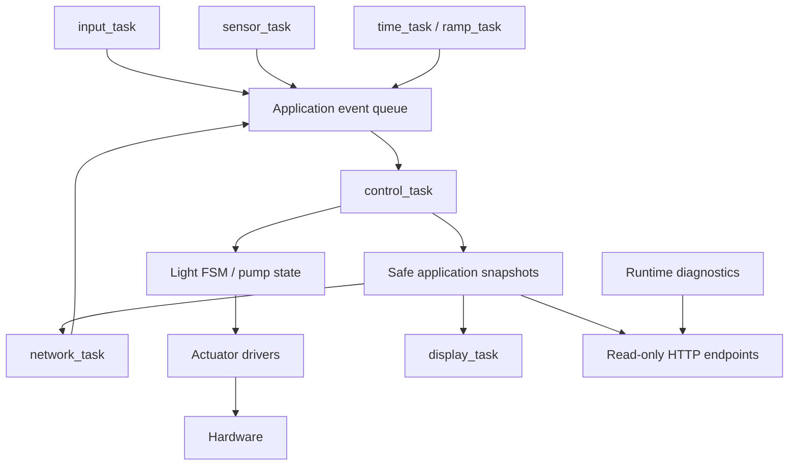

# GROW SYSTEM V0.2

GROW SYSTEM is an ESP32-S3 grow-environment prototype that combines environmental
monitoring, local actuator control, scheduled lighting and remote Blynk access.
V0.2 uses an event-driven FreeRTOS architecture with one owner of application
state and actuator decisions. Local HTTP diagnostics and a Python collector
support engineering validation and long-duration endurance tests.

## Contents

- [Overview](#overview) · [Features](#features) · [Hardware](#hardware)
- [Firmware architecture](#firmware-architecture) · [FreeRTOS tasks](#freertos-tasks)
- [Light control](#light-control) · [Blynk map](#blynk-map)
- [Diagnostics](#diagnostics) · [PC collector](#pc-collector)
- [Repository structure](#repository-structure) · [Build](#build)
- [Memory and partitions](#memory-and-partitions) · [Project status](#project-status)

## Overview

The device monitors a small grow environment and provides physical and remote
control of a pump and dimmable lighting. Local controls, sensor acquisition and
display updates continue when the network is unavailable. Automatic lighting
requires valid local time; manual controls remain available without SNTP.

## Features

- Temperature/humidity, capacitive soil moisture and ultrasonic water-level sensing.
- Analog LDR measurement, separate from commanded brightness.
- Manual pump control and 0–100% lighting control through four physical buttons.
- AUTO lighting with IDLE / DAWN / DUSK states and gradual brightness changes.
- Eight-field OLED interface with a 500 ms refresh period.
- Wi-Fi station connection, reconnection and SNTP time synchronization.
- Blynk HTTPS telemetry and remote pump/light/AUTO commands.
- Read-only local HTTP state and cumulative runtime diagnostics.
- PC-side CSV collection for planned 48–72 hour endurance runs.

## Hardware

| Component | Current prototype |
| --- | --- |
| MCU board | Waveshare ESP32-S3R2, 16 MB Flash, 240 MHz |
| Power supply | 12 V / 3 A |
| DC/DC converter | MP2307-type, 12 V → 5 V |
| Pump switching | HW-517 MOSFET module |
| Lighting interface | LC-LM358-PWM2V, PWM → 0–10 V |
| Temperature / humidity | GY-21 / HTU21D |
| Soil moisture | DFRobot capacitive soil moisture sensor |
| Water level | HC-SR04 ultrasonic sensor |
| Actual-light feedback | Analog LDR sensor |
| Display | 0.96-inch 128×64 I2C OLED |
| Local controls | Four buttons: pump, AUTO, light +, light − |

Pin assignments are centralized in [board_config.h](src/config/board_config.h).
Calibration and timing constants are in [app_config.h](src/config/app_config.h).
The hardware table identifies the prototype; it is not a wiring guide.

## Firmware architecture

**`control_task` is the single logical owner of application state and actuator
decisions.** Other application tasks produce queue events or consume coherent
snapshots. Sensor acquisition and network requests execute outside the control
task; diagnostics observe existing paths without taking control ownership.



The active startup path is `app_main()` in [main.c](src/main.c). Older functions
remain there as reference; their direct actuator and Blynk paths are inactive.
The custom OLED implementation is retained in [SSD1306_CustomLib.h](src/SSD1306_CustomLib.h).

## FreeRTOS tasks

| Task | Purpose | Period / trigger |
| --- | --- | --- |
| `control_task` | Process events, update state, apply actuator decisions | Queue events |
| `input_task` | Debounce physical buttons and publish commands | GPIO notifications; 10 ms sampling while active, 40 ms debounce |
| `sensor_task` | Acquire sensors and publish a sensor snapshot | 2 s |
| `display_task` | Render an application snapshot | 500 ms after startup screen |
| `network_task` | Wi-Fi status, Blynk commands and telemetry | Independent 5 s poll/upload timers; 5 s connection attempts |
| `time_task` | Publish local-time checks | 60 s |
| `ramp_task` | Publish brightness ramp ticks | 10 min |

The local HTTP server uses its ESP-IDF-managed task. There is no dedicated
diagnostics sampling task. Network requests can delay network work, but do not
execute in the control or sensor tasks.

## Light control

| Field | Meaning |
| --- | --- |
| `LIGHT_S` | Commanded brightness, 0–100% |
| `LIGHT_A` | Measured LDR level, 0–100% |
| `AUTO` | Enables automatic light-phase control |
| `MOD` | IDLE, DAWN or DUSK |

DAWN is scheduled at **06:00 local time**, DUSK at **20:00**. Ramps change
brightness by **5 percentage points every 10 minutes**; the DAWN target is **60%**.
Enabling AUTO evaluates the current day/night phase without an immediate brightness
step. If time is unavailable, phase selection waits for synchronization. Disabling
AUTO returns to IDLE while preserving brightness.

Manual and Blynk brightness commands remain available during DAWN/DUSK. They do
not cancel the active direction unless its endpoint is reached. DAWN never lowers
an above-target manual setting. **LDR is measurement-only and does not control PWM.**

## Blynk map

| Pin | Value | Direction |
| --- | --- | --- |
| V0 | Temperature | Device -> Blynk |
| V1 | Humidity | Device -> Blynk |
| V2 | Soil moisture | Device -> Blynk |
| V3 | Pump, 0/1 | Bidirectional |
| V4 | Water level | Device -> Blynk |
| V5 | LIGHT_S, 0–100% | Bidirectional |
| V6 | LIGHT_A / LDR, 0–100% | Device -> Blynk |
| V7 | AUTO, 0/1 | Bidirectional |
| V8 | MOD: 0 IDLE, 1 DAWN, 2 DUSK | Device -> Blynk |

**V8 is telemetry only.** Remote commands enter the same control queue as local
commands. Telemetry uses application snapshots rather than triggering sensor reads.

## Diagnostics

The local server exposes two read-only endpoints on port 80:

- `/api/state`: current application values, sensor validity and connection status.
- `/api/diagnostics`: uptime, sensor cycles/errors, Blynk results, Wi-Fi connection
  attempts, queue overflows, commands, ramp ticks/steps, deadline misses, free/minimum
  heap and task stack high-water marks.

Counters are cumulative RAM values and reset on reboot. Stack values are minimum
remaining free space in **bytes**, sampled by the tasks themselves. See
[runtime diagnostics](docs/runtime-diagnostics.md) for schemas, counter definitions,
sampling limits and hardware-test procedures, and [src/diagnostics](src/diagnostics)
for implementation.

> The prototype HTTP endpoints have no authentication. Use them on a trusted local
> network. They provide observation only and do not expose credentials.

## PC collector

[PC_collector](PC_collector/README.md) contains the standard-library Python collector
for 48–72 hour stress tests. It polls both HTTP endpoints every **10 seconds** by
default and writes one CSV per run, preserving valid data during partial failures.
Generated files under `PC_collector/LOGS/` are ignored by Git. Python 3.10+ is required.

```console
python PC_collector/collector.py
```

Stop with Ctrl+C to close the file and print the run summary. Configuration,
short-test options and collector tests are documented in its own README.

## Repository structure

```text
src/
├── app/                # State, event queue and light FSM
├── config/             # Pin mapping, calibration and periods
├── diagnostics/        # RAM counters, JSON and HTTP server
├── drivers/            # Sensors, buttons and actuator drivers
├── services/           # Network and local-time services
├── tasks/              # FreeRTOS application tasks
├── SSD1306_CustomLib.h # Custom OLED implementation
└── main.c              # Active startup and reference-only legacy code
PC_collector/
├── collector.py
├── test_collector.py
├── README.md
└── LOGS/
test/                   # Host tests and hardware/API stubs
docs/                   # Architecture notes and diagnostics reference
Basic_bredboard/        # KiCad prototype project
platformio.ini
sdkconfig.esp32s3
sdkconfig.defaults
partitions.csv
```

## Build

The firmware uses **ESP-IDF through PlatformIO**, targeting ESP32-S3 with the
`esp32s3` environment. The verified development workflow uses Windows 11 and
VS Code/PlatformIO; host C test instructions use Visual Studio Build Tools.
Run from the repository root:

```console
pio run -e esp32s3
pio run -e esp32s3 -t upload
pio device monitor -e esp32s3
```

Monitor speed is **115200 baud**. Normal PlatformIO upload includes the bootloader,
partition table and application. Configure the existing network credential settings
locally before deploying to a different network; do not publish personal values.
Host tests and their commands are documented under [test](test) and
[PC_collector](PC_collector/README.md).

## Memory and partitions

The physical board has **16 MB Flash**. ESP-IDF and PlatformIO select the custom
[partitions.csv](partitions.csv): the factory application starts at `0x10000` and
has size **`0x180000` (1.5 MiB)**. NVS remains in its own partition at `0x9000`.
Flash mode is DIO; ESP-IDF PSRAM support is currently disabled.

## Project status

The prototype, local controls, automatic lighting and Blynk integration have been
exercised on hardware. Diagnostics and the PC collector are operational; a short
collector run has successfully read both live endpoints. Endurance-test
infrastructure is prepared, but no completed **48–72 hour endurance result** is
claimed. Detailed wiring, device operation and validation reports belong in
separate documentation.
