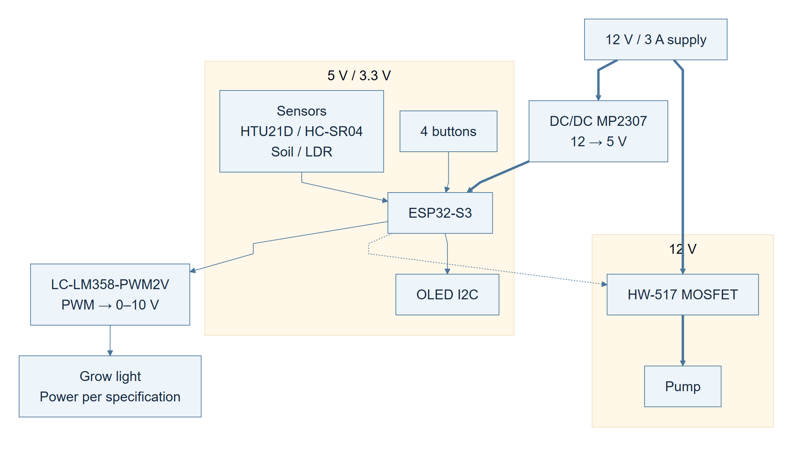
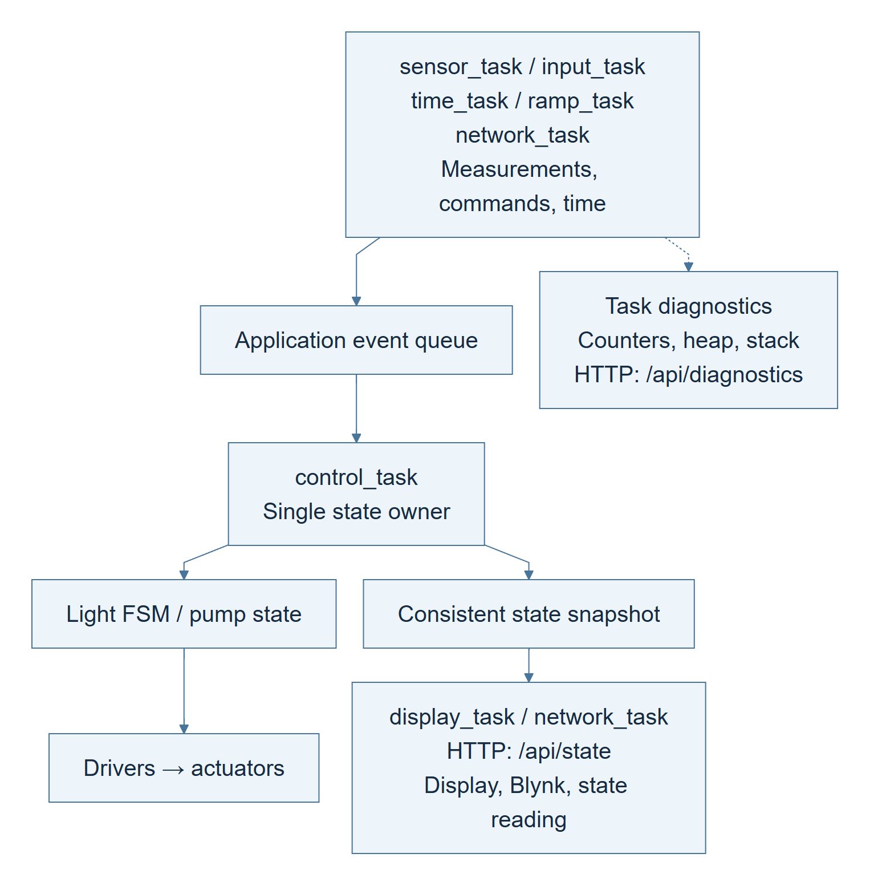
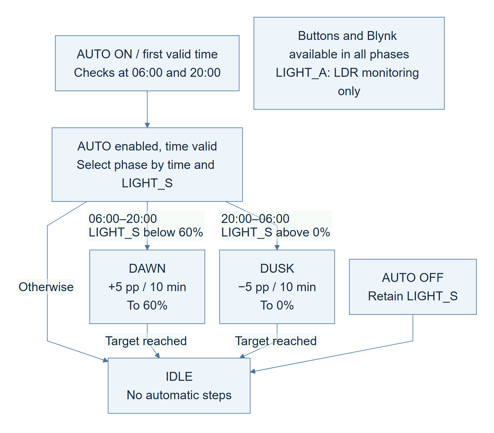
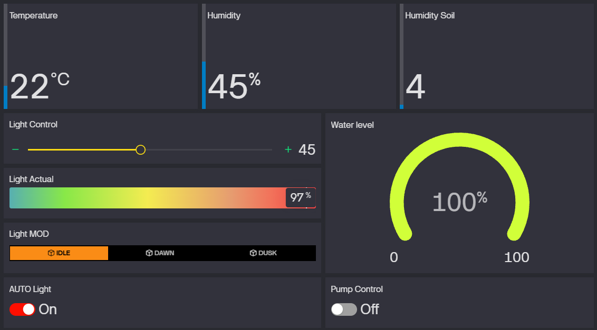
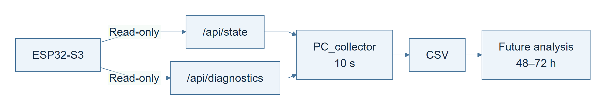

# GROW SYSTEM V0.2

Prototype Technical Overview

ESP32-S3 / FreeRTOS

## 1. General information

GROW SYSTEM is a prototype for monitoring and controlling a plant-growing space. It combines environmental measurements, pump and lighting control, a local display and remote access through Blynk. V0.2 firmware runs on ESP32-S3 with ESP-IDF and FreeRTOS.

This document describes the device and software architecture. It does not replace an electrical schematic, a user manual or a test report.

## 2. Device purpose

The device is intended to monitor temperature, air and substrate moisture, water level and relative light level. Users control the pump and brightness using buttons or Blynk and can enable automatic lighting phase changes.

The pump is controlled manually; automatic irrigation and plant profiles are not implemented. The LDR is used for monitoring and does not adjust PWM. Percentage sensor readings do not imply independently verified measurement accuracy.

## 3. Main functions

- Measurements from HTU21D, a capacitive soil sensor, HC-SR04 and an LDR.
- Filtering of HC-SR04 distance and conversion to water level using configured limits.
- Pump and 0–100% brightness control, with four physical buttons.
- Automatic lighting control: `IDLE`, `DAWN`, `DUSK`.
- Eight fields on the OLED; refresh every 500 ms.
- Wi-Fi, SNTP time synchronization, Blynk commands and telemetry.
- Local HTTP state and diagnostic snapshots; CSV collection on a PC.

## 4. Hardware

Table 1 — Main hardware components.

| Block | Component | Purpose |
| --- | --- | --- |
| Controller | Waveshare ESP32-S3R2; 240 MHz; 16 MB Flash | Event, measurement and communication processing |
| Power | 12 V / 3 A supply | Prototype power |
| DC/DC | MP2307-type, 12 → 5 V | Board and logic power |
| Pump switching | HW-517, MOSFET | Pump on/off switching |
| Light control | LC-LM358-PWM2V | PWM → 0–10 V conversion |
| Temperature / humidity | GY-21 / HTU21D | Air measurements |
| Soil | DFRobot capacitive sensor | Substrate moisture estimate |
| Water | HC-SR04 | Distance to the water surface |
| Light | Analog LDR | Relative light level |
| Display | 0.96-inch OLED, 128×64, I2C | State display |
| Buttons | Four physical inputs | Pump, AUTO, brightness +/− |

Soil and LDR measurements use separate ADC1 channels. HTU21D and OLED share an I2C bus. Pin assignments are defined in `board_config.h`; periods and calibration limits are defined in `app_config.h`.

## 5. Hardware structural diagram

Figure 1 — Hardware blocks and power separation.

The 12 V supply feeds the pump power branch and the DC/DC converter. The 5 V output powers the board; the logic branch includes 5 V / 3.3 V circuits. Thick arrows show the main power paths; other arrows show signal connections. This separation does not imply galvanic isolation.

This is a structural diagram: power for individual sensors and the PWM converter is not detailed. Grow-light power is determined by its specifications, not by the 0–10 V control input. Level matching, common circuits and load protection belong in separate electrical documentation.

## 6. Software architecture

Measurement, button, time and network tasks send events to the application event queue. `control_task` is the sole logical owner of application state and actuator decisions. It applies light and pump logic, calls drivers and publishes state.

Other tasks obtain a consistent state snapshot through `app_state_get_snapshot()`. The sensor task does not control PWM; the network does not switch the pump directly. Measurements and network requests run outside the control handlers.

On a sensor error, the last correct value is retained. It is assessed together with the validity flag and current error code. Local commands, measurements and the display continue without a network connection; automatic phase selection requires valid local time.

## 7. Task interaction architecture

Figure 2 — Events, control, state snapshots and diagnostics.

Table 2 — FreeRTOS tasks and operating periods.

| Task | Purpose | Trigger / period |
| --- | --- | --- |
| `control_task` | Events and control | Queued event |
| `input_task` | Buttons and debouncing | 10 ms sampling while active; 40 ms debounce |
| `sensor_task` | Measurement and publication | 2 s |
| `display_task` | State snapshot on OLED | 500 ms after the startup screen |
| `network_task` | Blynk communication | 5 s polling; 5 s telemetry |
| `time_task` | Local time check | 60 s |
| `ramp_task` | Brightness step event | 10 min |

Blynk polling and telemetry have independent timers. The HTTP server uses an ESP-IDF task. Existing modules update counters without a separate diagnostic task. Disabled legacy logic in `main.c` is not part of the active architecture.

## 8. Lighting control logic

Table 3 — Control and monitoring fields.

| Field | Meaning |
| --- | --- |
| `LIGHT_S` | System-commanded level, 0–100% |
| `LIGHT_A` | LDR reading, 0–100%; not a lux measurement |
| `AUTO` | Enables automatic phase selection |
| `MOD` | `IDLE`, `DAWN` or `DUSK` state |

Enabling AUTO during the day, from 06:00 to 20:00, starts DAWN when the level is below the 60% target. At night, a level above zero starts DUSK. If the target has been reached, the state remains IDLE. Without synchronization, the device waits for the first valid time and then selects the phase.

Scheduled checks are DAWN at 06:00 and DUSK at 20:00 local time, checked once per minute. Phase selection does not immediately change brightness; the next `APP_EVT_LIGHT_RAMP_TICK` event changes it by 5 percentage points. The step period is 10 minutes. The timer is independent of AUTO, so the first step may occur before a full interval has elapsed.

Figure 3 — Phase selection and commanded brightness changes.

Buttons and Blynk remain available during DAWN/DUSK. A manual command retains the cycle direction until its boundary: at 60% or above, DAWN ends without reducing brightness; DUSK ends at zero. AUTO OFF stops the cycle and retains LIGHT_S. The LDR is monitoring-only; there is no LIGHT_A → PWM feedback.

## 9. Blynk integration

Table 4 — Blynk virtual pin mapping.

| Pin | Field | Direction |
| --- | --- | --- |
| V0 | TEMP - temperature | Device → Blynk |
| V1 | HUM - air humidity | Device → Blynk |
| V2 | SOIL - soil moisture | Device → Blynk |
| V3 | PUMP, 0/1 | Command and state |
| V4 | WATER - water level | Device → Blynk |
| V5 | LIGHT_S, 0–100% | Command and state |
| V6 | LIGHT_A / LDR, 0–100% | Device → Blynk |
| V7 | AUTO, 0/1 | Command and state |
| V8 | MOD: 0 IDLE, 1 DAWN, 2 DUSK | Telemetry only |

Figure 4 — GROW SYSTEM monitoring and control dashboard in Blynk.

The dashboard combines sensor telemetry, commanded and measured light levels, automation state, pump control and water-level display. Screenshot values illustrate the interface, not results of a complete-system test.

The service uses HTTPS. Polling accepts V3, V5 and V7 and produces application events; V8 is telemetry-only. Uploading publishes a snapshot without taking new measurements. Unchanged values and echoes of the device's own uploads should not produce repeated commands.

REST communication is not atomic: a command arriving between reading and writing state may be overwritten by the next upload. This is a limitation of the current implementation.

## 10. Diagnostics and data collection

`/api/state` returns actuator state, measurements, validity and sensor errors. `/api/diagnostics` returns uptime, event and error counters, heap and stack margin. Local HTTP interfaces are read-only; the prototype has no authentication. Diagnostics observe device operation separately from normal control.

Figure 5 — Diagnostic data flow toward future analysis.

Counters cover sensor cycles and errors, HC-SR04 timeouts, Blynk operations and errors, Wi-Fi connection attempts, queue overflows, commands and lighting steps. `task_deadline_misses` records large delays in sensor/display/time/ramp tasks: period overrun greater than the maximum of 250 ms and 10% of the period. It does not measure every possible delay.

Counters reside in RAM and reset on reboot. A short critical section protects updates and copying; JSON is generated outside it. Uptime is independent of SNTP. Heap metrics include current free memory and the minimum since boot. Stack margin is the minimum free space in bytes, sampled periodically by the task, not its allocated stack size. `wifi_reconnects` includes the initial connection attempt.

By default, `PC_collector` polls both interfaces every 10 s and saves one CSV row per cycle: time, UTC offset, success flags and values. Requests are sequential; snapshots are not atomic. On partial failure, available data is retained and missing fields remain empty. Each row is followed by `flush()` and `fsync()`. There are no accumulated Flash logs or periodic NVS writes.

The infrastructure is ready for a future complete-system test lasting 48–72 hours; completion of such a test is not claimed. Full operational data analysis will be performed separately after the complete hardware configuration is installed in the growbox. Endurance-run results, telemetry charts and diagnostic counter statistics will be presented in a separate technical report.

## 11. Current prototype status

The hardware prototype, local control, lighting automation, OLED and Blynk integration are operational at prototype level. The sensor architecture is implemented; diagnostics and PC_collector operate. This does not confirm completed validation of the entire hardware configuration in the growbox.

The earlier CSV was collected without the soil sensor and HC-SR04 participating in a complete test, and without the installed grow light and full growbox lighting environment. Changes in LIGHT_S do not make LIGHT_A a measurement of the grow light's actual response. Numerical results from that run are excluded from this overview and are not used to assess the complete system.

## 12. Conclusion

GROW SYSTEM V0.2 combines measurements, local commands and remote commands in an event-driven architecture with one owner of control state. Separate state and diagnostic snapshots support observation and preparation for further validation. The next validation stage is a test of the complete growbox configuration with a separate technical report.
