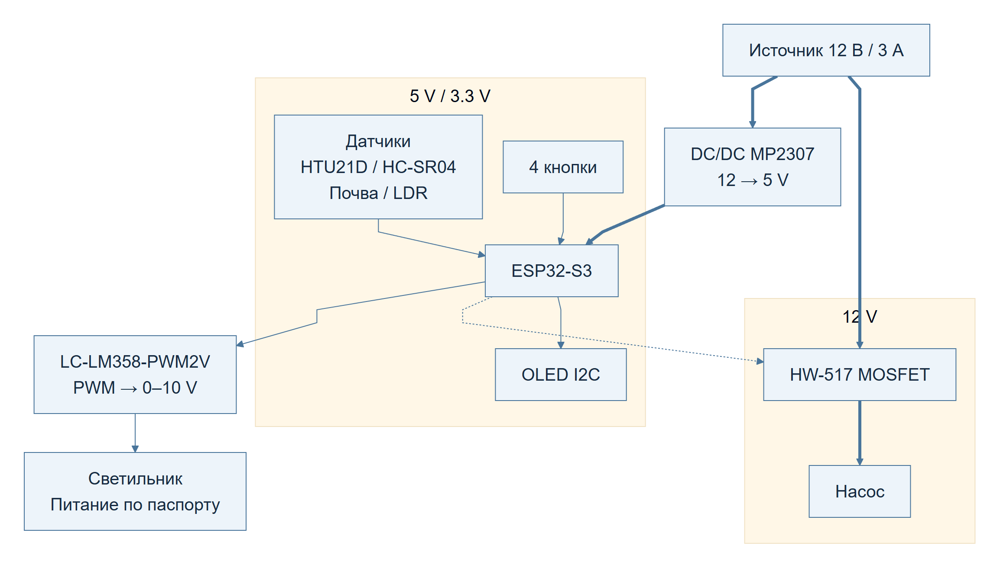
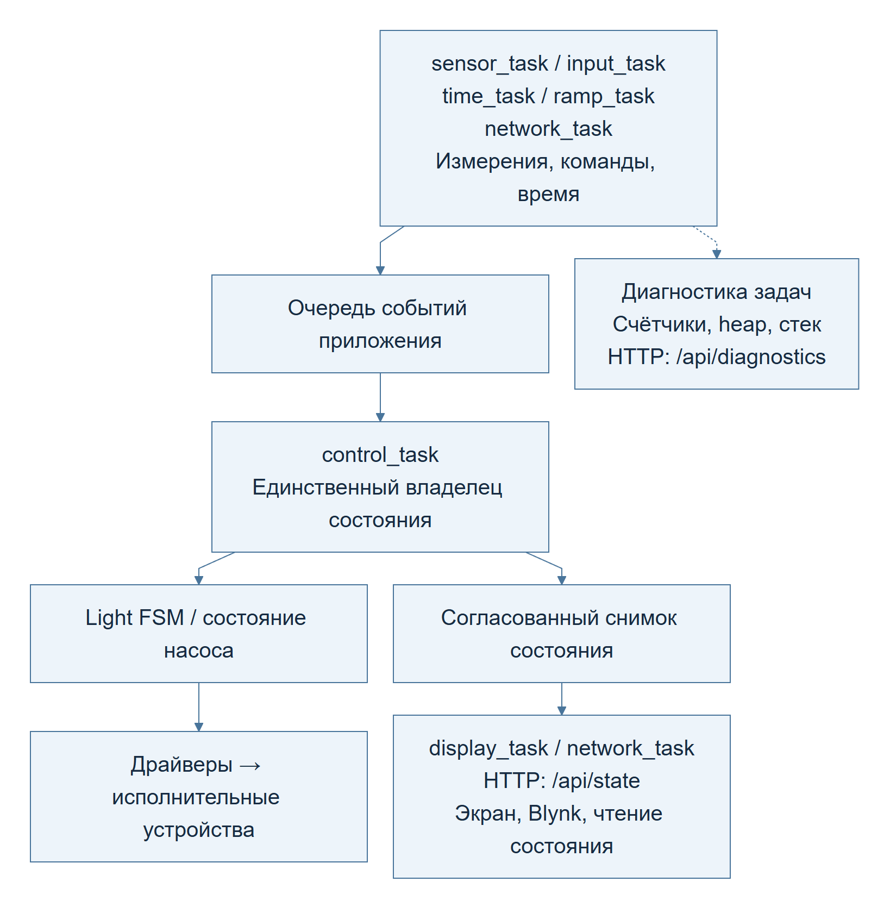
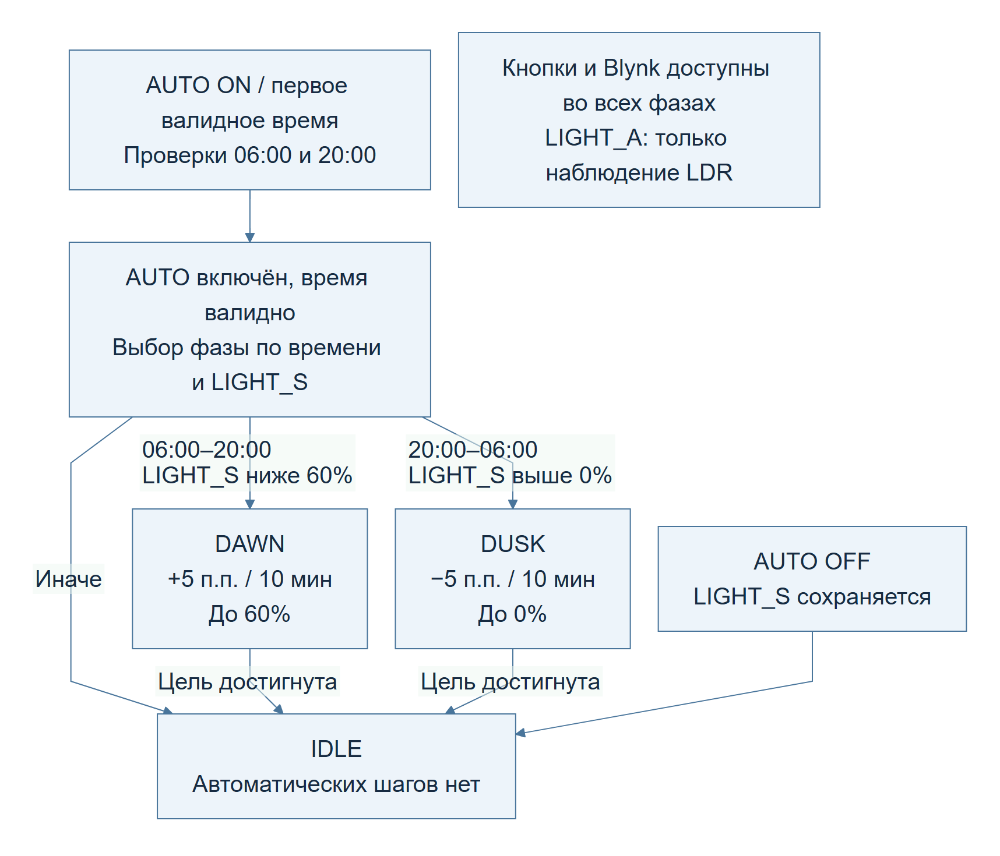
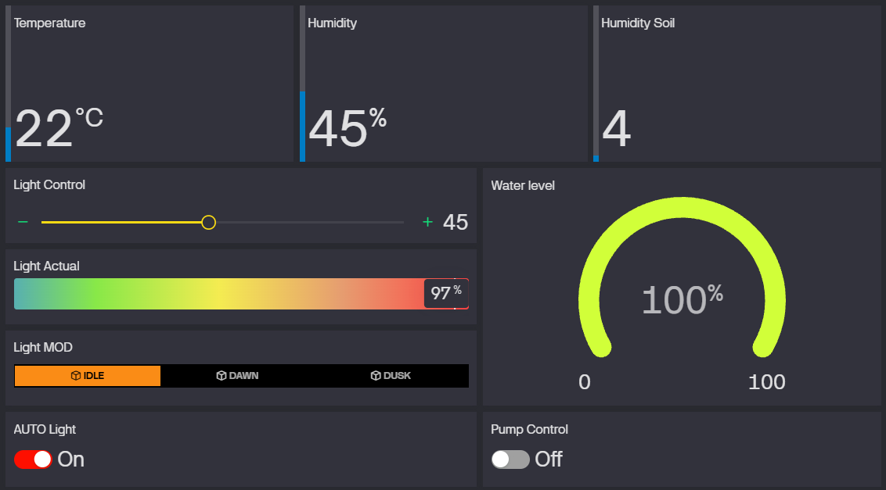
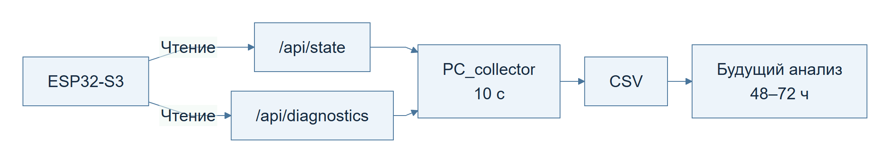

# GROW SYSTEM V0.2

Техническое описание прототипа

ESP32-S3 / FreeRTOS

## 1. Общая информация

GROW SYSTEM - прототип системы наблюдения и управления пространством для выращивания растений. Он объединяет измерение параметров среды, управление насосом и освещением, локальный экран и удалённый доступ через Blynk. Прошивка V0.2 работает на ESP32-S3 с ESP-IDF и FreeRTOS.

Документ описывает устройство и программную архитектуру. Он не заменяет электрическую схему, руководство пользователя или протокол испытаний.

## 2. Назначение устройства

Устройство предназначено для наблюдения за температурой, влажностью воздуха и субстрата, уровнем воды и относительным освещением. Пользователь управляет насосом и яркостью с кнопок или через Blynk, а также включает автоматическую смену световых фаз.

Насос управляется вручную; автоматический полив и профили растений не реализованы. LDR используется для наблюдения и не корректирует PWM. Процентные показания датчиков не означают независимо подтверждённую точность измерений.

## 3. Основные функции

- Измерения HTU21D, ёмкостного датчика почвы, HC-SR04 и LDR.
- Фильтрация расстояния HC-SR04 и пересчёт в уровень воды по заданным границам.
- Управление насосом и яркостью 0–100%, четыре физические кнопки.
- Автоматическое управление освещением: `IDLE`, `DAWN`, `DUSK`.
- Восемь полей на OLED; обновление каждые 500 мс.
- Wi-Fi, синхронизация времени SNTP, команды и телеметрия Blynk.
- Локальные HTTP-снимки состояния и диагностики; сбор CSV на ПК.

## 4. Аппаратная часть

Таблица 1 — Основные аппаратные компоненты.

| Узел | Компонент | Назначение |
| --- | --- | --- |
| Контроллер | Waveshare ESP32-S3R2; 240 МГц; Flash 16 МБ | Обработка событий, измерений и связи |
| Питание | Источник 12 В / 3 А | Питание прототипа |
| DC/DC | MP2307-типа, 12 → 5 В | Питание платы и логики |
| Коммутация насоса | HW-517, MOSFET | Включение и выключение насоса |
| Управление светом | LC-LM358-PWM2V | Преобразование PWM → 0–10 В |
| Температура / влажность | GY-21 / HTU21D | Измерение состояния воздуха |
| Почва | Ёмкостный датчик DFRobot | Оценка влажности субстрата |
| Вода | HC-SR04 | Расстояние до поверхности воды |
| Свет | Аналоговый LDR | Относительное освещение |
| Экран | OLED 0,96 дюйма, 128×64, I2C | Отображение состояния |
| Кнопки | Четыре физических входа | Насос, AUTO, яркость +/− |

Почва и LDR используют разные каналы ADC1. HTU21D и OLED работают на общей шине I2C. Назначения выводов заданы в `board_config.h`, периоды и калибровочные границы - в `app_config.h`.

## 5. Структурная схема устройства

Рисунок 1 — Аппаратные блоки и разделение питания.

Источник 12 В питает силовую ветвь насоса и DC/DC. Выход 5 В питает плату; логическая часть включает цепи 5 В / 3,3 В. Толстые стрелки показывают основные пути питания, остальные - сигнальные связи. Такое разделение не означает гальваническую развязку.

Схема структурная: питание отдельных датчиков и преобразователя PWM не детализировано. Питание светильника определяется его паспортом, а не входом управления 0–10 В. Согласование уровней, общие цепи и защита нагрузок относятся к отдельной электрической документации.

## 6. Программная архитектура

Задачи измерений, кнопок, времени и сети передают события в очередь событий приложения. `control_task` - единственный логический владелец состояния приложения и решений об исполнительных устройствах. Она применяет логику света и насоса, вызывает драйверы и публикует состояние.

Другие задачи получают согласованный снимок состояния через `app_state_get_snapshot()`. Задача датчиков не управляет PWM, сеть не переключает насос напрямую. Измерения и сетевые запросы выполняются вне обработчиков управления.

При ошибке датчика сохраняется последнее корректное значение. Его оценивают вместе с признаком валидности и кодом текущей ошибки. Без сети локальные команды, измерения и экран продолжают работать; автоматический выбор фазы требует валидного локального времени.

## 7. Архитектура взаимодействия задач

Рисунок 2 — События, управление, снимки состояния и диагностика.

Таблица 2 — Задачи FreeRTOS и периоды работы.

| Задача | Назначение | Запуск / период |
| --- | --- | --- |
| `control_task` | События и управление | Событие в очереди |
| `input_task` | Кнопки и подавление дребезга | Выборка 10 мс при активности; дребезг 40 мс |
| `sensor_task` | Измерения и публикация | 2 с |
| `display_task` | Снимок состояния на OLED | 500 мс после стартового экрана |
| `network_task` | Обмен с Blynk | Опрос 5 с; телеметрия 5 с |
| `time_task` | Проверка локального времени | 60 с |
| `ramp_task` | Событие шага яркости | 10 мин |

Опрос и телеметрия Blynk имеют независимые таймеры. HTTP-сервер использует задачу ESP-IDF. Счётчики обновляют существующие модули без отдельной задачи диагностики. Отключённая старая логика в `main.c` не относится к активной архитектуре.

## 8. Логика управления освещением

Таблица 3 — Поля управления и наблюдения.

| Поле | Смысл |
| --- | --- |
| `LIGHT_S` | Заданный системой уровень, 0–100% |
| `LIGHT_A` | Показание LDR, 0–100%; не измерение в люксах |
| `AUTO` | Разрешение автоматического выбора фазы |
| `MOD` | Состояние `IDLE`, `DAWN` или `DUSK` |

При включении AUTO днём, с 06:00 до 20:00, уровень ниже цели 60% запускает DAWN. Ночью уровень выше нуля запускает DUSK. Если целевой уровень достигнут, остаётся IDLE. Без синхронизации устройство ждёт первого валидного времени и затем определяет фазу.

Плановые проверки: DAWN в 06:00, DUSK в 20:00 местного времени, с проверкой раз в минуту. Фаза выбирается без немедленного изменения яркости; следующее событие `APP_EVT_LIGHT_RAMP_TICK` меняет её на 5 процентных пунктов. Период шага - 10 минут. Таймер независим от AUTO, поэтому первый шаг может наступить раньше полного интервала.

Рисунок 3 — Выбор фазы и изменение заданной яркости.

Кнопки и Blynk доступны во время DAWN/DUSK. Ручная команда сохраняет направление цикла до его границы: при 60% или выше DAWN завершается без снижения яркости; DUSK завершается при нуле. AUTO OFF останавливает цикл и сохраняет LIGHT_S. LDR служит только для наблюдения; обратной связи LIGHT_A → PWM нет.

## 9. Интеграция с Blynk

Таблица 4 — Соответствие виртуальных пинов Blynk.

| Пин | Поле | Направление |
| --- | --- | --- |
| V0 | TEMP - температура | Устройство → Blynk |
| V1 | HUM - влажность воздуха | Устройство → Blynk |
| V2 | SOIL - влажность почвы | Устройство → Blynk |
| V3 | PUMP, 0/1 | Команда и состояние |
| V4 | WATER - уровень воды | Устройство → Blynk |
| V5 | LIGHT_S, 0–100% | Команда и состояние |
| V6 | LIGHT_A / LDR, 0–100% | Устройство → Blynk |
| V7 | AUTO, 0/1 | Команда и состояние |
| V8 | MOD: 0 IDLE, 1 DAWN, 2 DUSK | Только телеметрия |

Рисунок 4 — Панель мониторинга и управления GROW SYSTEM в Blynk.

Панель объединяет телеметрию датчиков, заданный и измеренный уровни света, состояние автоматики, управление насосом и отображение воды. Значения на скриншоте иллюстрируют интерфейс, а не результаты испытания полной системы.

Сервис использует HTTPS. Опрос принимает V3, V5 и V7 и формирует события приложения; V8 - только телеметрия. Отправка публикует снимок без новых измерений. Неизменные значения и эхо собственной отправки не должны создавать повторные команды.

REST-обмен не атомарен: команда между чтением и записью состояния может быть перезаписана последующей отправкой. Это ограничение текущей реализации.

## 10. Диагностика и сбор данных

`/api/state` возвращает состояние исполнительных устройств, измерения, валидность и ошибки датчиков. `/api/diagnostics` возвращает uptime, счётчики событий и ошибок, heap и запас стека. Локальные HTTP-интерфейсы доступны только для чтения; аутентификация в прототипе отсутствует. Диагностика наблюдает работу устройства отдельно от обычного управления.

Рисунок 5 — Путь диагностических данных к будущему анализу.

Счётчики охватывают циклы и ошибки датчиков, тайм-ауты HC-SR04, операции и ошибки Blynk, попытки подключения Wi-Fi, переполнения очереди, команды и шаги освещения. `task_deadline_misses` учитывает крупные задержки задач sensor/display/time/ramp: превышение периода больше максимума из 250 мс и 10% периода. Это не измеритель всех возможных задержек.

Счётчики находятся в RAM и сбрасываются при перезагрузке. Короткая критическая секция защищает обновление и копирование; JSON формируется вне неё. Uptime не зависит от SNTP. Heap включает текущую свободную память и минимум с загрузки. Запас стека - минимальный свободный остаток в байтах, периодически считываемый задачей, а не выделенный размер стека. `wifi_reconnects` включает первоначальную попытку подключения.

`PC_collector` по умолчанию опрашивает оба интерфейса каждые 10 с и сохраняет одну строку CSV на цикл: время, UTC-смещение, флаги успеха и значения. Запросы последовательные, снимки не атомарны. При частичном сбое доступные данные сохраняются, отсутствующие поля остаются пустыми. После строки выполняются `flush()` и `fsync()`. Накопительных журналов во Flash и периодических записей в NVS нет.

Инфраструктура готова для будущего полного испытания длительностью 48–72 часа; завершение такого испытания не заявляется. Полноценный анализ эксплуатационных данных будет выполнен отдельно после установки полной аппаратной конфигурации в growbox. Результаты длительного прогона, графики телеметрии и статистика диагностических счётчиков будут оформлены в отдельном техническом отчёте.

## 11. Текущий статус прототипа

Аппаратный прототип, локальное управление, автоматическое освещение, OLED и интеграция Blynk работоспособны на уровне прототипа. Архитектура датчиков реализована; диагностика и PC_collector работают. Это не подтверждение завершённой проверки всей аппаратной конфигурации в growbox.

Ранее собранный CSV получен без участия датчика почвы и HC-SR04 в полноценном испытании, без установленного светильника и полной световой среды growbox. Изменения LIGHT_S не позволяют считать LIGHT_A измерением реального отклика светильника. Числовые результаты этого прогона не включены в обзор и не используются для оценки полной системы.

## 12. Заключение

GROW SYSTEM V0.2 объединяет измерения, локальные и удалённые команды в событийной архитектуре с единым владельцем управляющего состояния. Раздельные снимки состояния и диагностики позволяют наблюдать поведение устройства и готовить дальнейшую проверку. Следующий этап валидации - испытание полной конфигурации в growbox с отдельным техническим отчётом.
