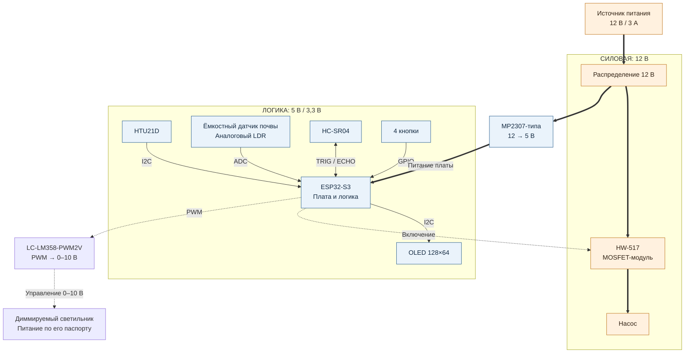
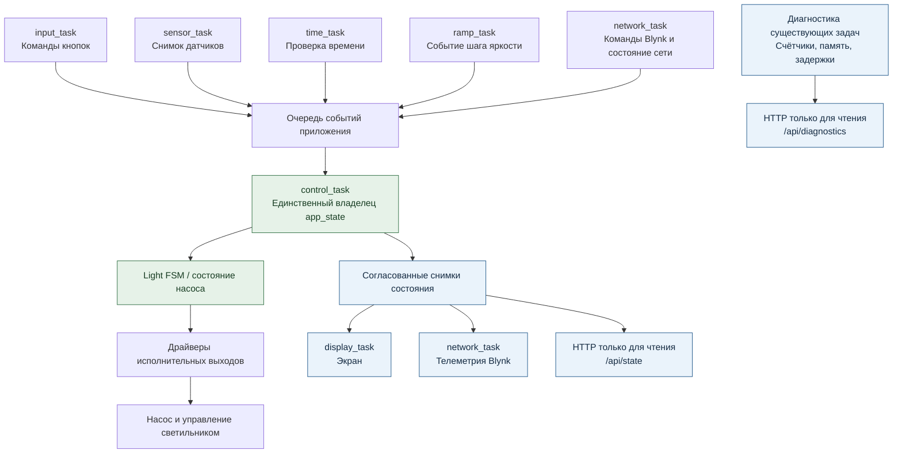
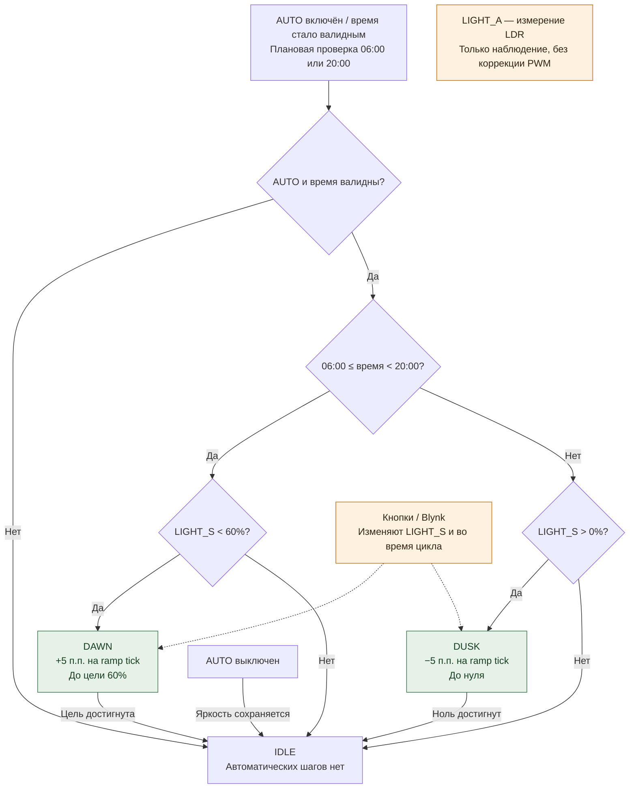
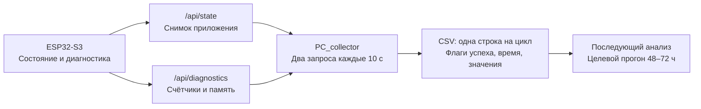
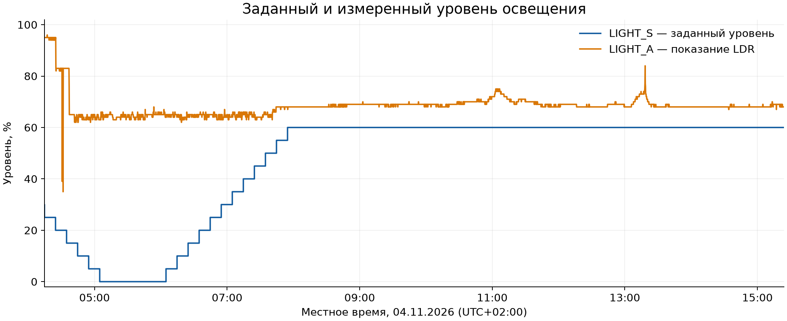
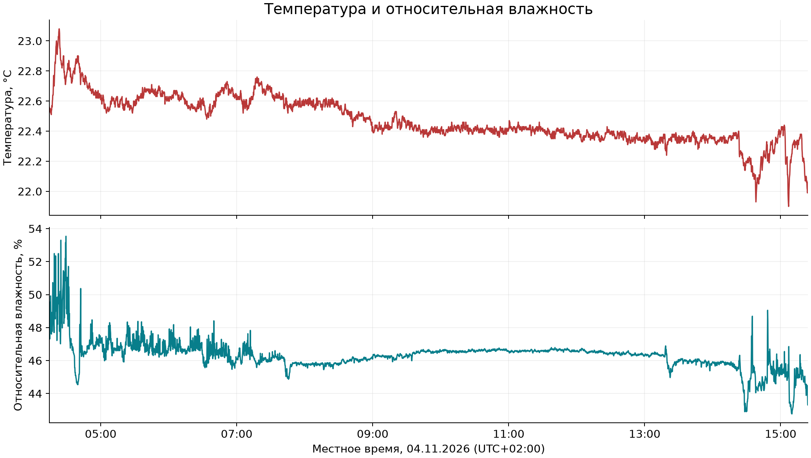

# GROW SYSTEM V0.2

Технический обзор устройства и предварительных эксплуатационных данных. Версия
описания соответствует активной ветке `develop/firmware-v0.2-rtos`. Документ
подготовлен как исходный материал для последующей PDF-вёрстки; он не заменяет
электрическую схему и протокол испытаний.

## 1. Общая информация

GROW SYSTEM — работающий прототип системы наблюдения и управления небольшим
пространством для выращивания растений. Устройство объединяет измерение параметров
среды, управление насосом и освещением, локальный интерфейс и удалённый доступ через
Blynk. Контроллер ESP32-S3 выполняет прошивку V0.2 на базе ESP-IDF и FreeRTOS.

Основная особенность программной части — разделение измерений, приёма команд и
применения управляющих решений. Состояние приложения изменяет одна задача; другие
задачи передают ей события или читают согласованные снимки состояния. Диагностика
позволяет наблюдать работу этой структуры без изменения алгоритмов управления.

## 2. Назначение устройства

Прототип предназначен для контроля температуры, влажности воздуха, влажности
субстрата, уровня воды и относительного уровня освещения. Пользователь может
управлять насосом и яркостью с физических кнопок или через Blynk, а также включать
автоматическую смену световой фазы.

Насос управляется вручную: автоматический полив и растительные профили в текущей
версии не реализованы. Показания LDR используются для наблюдения, а не для
автоматической коррекции яркости. Эти границы важны при интерпретации возможностей
устройства и результатов измерений.

## 3. Основные функции

- Измерение температуры и относительной влажности датчиком HTU21D.
- Получение процентных показаний ёмкостного датчика почвы и LDR.
- Измерение расстояния до поверхности воды HC-SR04 с фильтрацией и пересчётом
  в уровень по заданным геометрическим границам.
- Управление насосом и яркостью 0–100%, четыре физические кнопки.
- Автоматическое освещение с состояниями `IDLE`, `DAWN`, `DUSK`.
- Отображение восьми полей на OLED, обновление каждые 500 мс.
- Wi-Fi, синхронизация времени SNTP, обмен телеметрией и командами с Blynk.
- Локальные HTTP-снимки состояния и накопительная диагностика в RAM.
- Сбор двух HTTP-снимков в общий CSV на ПК для продолжительных наблюдений.

## 4. Аппаратная часть

| Узел | Компонент | Назначение |
| --- | --- | --- |
| Контроллер | Waveshare ESP32-S3R2, 240 МГц, Flash 16 МБ | Обработка событий, измерений и сетевого обмена |
| Основное питание | Источник 12 В / 3 А | Питание прототипа |
| Понижающий преобразователь | MP2307-типа, 12 → 5 В | Питание платы и логической ветви |
| Коммутация насоса | MOSFET-модуль HW-517 | Включение и выключение насоса |
| Управление светом | LC-LM358-PWM2V, PWM → 0–10 В | Передача заданной яркости диммируемому светильнику |
| Температура и влажность | GY-21 / HTU21D | Измерение состояния воздуха |
| Почва | Ёмкостный датчик DFRobot | Оценка влажности субстрата |
| Вода | HC-SR04 | Измерение расстояния до воды |
| Свет | Аналоговый LDR | Относительное измерение освещения |
| Экран | OLED 0,96 дюйма, 128×64, I2C | Локальное отображение состояния |
| Кнопки | Четыре физических входа | Насос, AUTO, увеличение и уменьшение яркости |

Назначения выводов находятся в [board_config.h](../src/config/board_config.h),
калибровочные границы — в [app_config.h](../src/config/app_config.h). Почва и LDR
используют разные каналы одного ADC1; HTU21D и OLED работают на общей шине I2C.
Процентные значения — результат заданного преобразования показаний, а не
независимо подтверждённая метрологическая точность.

## 5. Структурная схема устройства

Толстые линии обозначают основные пути питания, пунктирные — управление
исполнительными устройствами. Остальные связи показывают обмен с периферией.
Питание датчиков, преобразователя PWM и светильника здесь не детализировано.
Разделение силовой и логической ветвей не означает гальваническую развязку.

> Это структурная схема, а не инструкция по подключению. Напряжения конкретных
> входов, согласование сигналов, общие цепи и защита нагрузок должны быть указаны
> в отдельной электрической документации. Питание светильника нельзя определять
> только по наличию управляющего входа 0–10 В.

[Схема в SVG](assets/hardware-architecture.svg) · [Схема в PNG](assets/hardware-architecture.png).

## 6. Программная архитектура

`control_task` — единственный логический владелец состояния приложения и решений
об исполнительных выходах. Она принимает события из общей очереди, применяет
логику света или насоса, обращается к драйверам и публикует новое состояние.
Входные события включают кнопки, удалённые команды, измерения и уведомления времени.

Задача датчиков не управляет PWM, а задача сети не переключает насос напрямую.
Экран, телеметрия Blynk и локальные HTTP-обработчики читают копии состояния через
`app_state_get_snapshot()`. Сетевые запросы и измерения не выполняются внутри
обработчиков управления.

На ошибке чтения датчика сохраняется последнее корректное значение, а код ошибки
описывает текущую попытку. Поэтому число в снимке следует оценивать вместе с
признаком валидности и кодом ошибки. При отсутствии сети локальное управление,
измерения и экран продолжают работу; автоматический выбор фазы требует валидного
локального времени.

## 7. Архитектура взаимодействия задач

[Схема в SVG](assets/software-architecture.svg) · [Схема в PNG](assets/software-architecture.png).

| Задача | Назначение | Период или источник запуска |
| --- | --- | --- |
| `control_task` | Обработка событий и применение решений | Поступление события в очередь |
| `input_task` | Подавление дребезга и команды кнопок | GPIO; выборка 10 мс при активности, дребезг 40 мс |
| `sensor_task` | Получение и публикация измерений | 2 с |
| `display_task` | Отображение снимка состояния | 500 мс после стартового экрана |
| `network_task` | Обмен с Blynk и состояние связи | Опрос 5 с и телеметрия 5 с, независимые таймеры |
| `time_task` | Проверка местного времени | 60 с |
| `ramp_task` | Публикация события изменения яркости | 10 мин |

HTTP-сервер работает в задаче, создаваемой ESP-IDF. Отдельной задачи накопления
диагностики нет: счётчики обновляют существующие модули. Старая логика, оставленная
в `main.c` для справки, не является частью активной архитектуры V0.2.

## 8. Логика управления освещением

| Поле | Смысл |
| --- | --- |
| `LIGHT_S` | Заданный системой уровень яркости, 0–100% |
| `LIGHT_A` | Процентное показание LDR, 0–100%; не измерение в люксах |
| `AUTO` | Разрешение автоматического выбора световой фазы |
| `MOD` | Текущее состояние: `IDLE`, `DAWN` или `DUSK` |

При включении AUTO днём, с 06:00 до 20:00, яркость ниже цели запускает DAWN.
Ночью яркость выше нуля запускает DUSK. Если нужный уровень уже достигнут,
сохраняется IDLE. При отсутствии синхронизированного времени устройство ждёт
первого валидного времени и затем однократно определяет фазу.

[Схема в SVG](assets/light-control.svg) · [Схема в PNG](assets/light-control.png).

Плановые проверки сохраняются: DAWN начинается в 06:00, DUSK — в 20:00 местного
времени. Проверка выполняется раз в минуту, поэтому реакция не привязана к точной
нулевой секунде. Фаза выбирается без немедленного изменения яркости; шаг выполняет
следующее событие `APP_EVT_LIGHT_RAMP_TICK`. Его период — 10 минут, величина шага —
5 процентных пунктов. Таймер шага работает независимо от момента включения AUTO,
поэтому первый шаг не обязан ждать полные 10 минут после команды.

Кнопки и Blynk доступны во время DAWN/DUSK. Ручное изменение обычно сохраняет
направление автоматического цикла. При достижении или превышении 60% во время DAWN
цикл завершается без уменьшения яркости; DUSK завершается при нуле. AUTO OFF
останавливает цикл, сохраняя текущий LIGHT_S. Обратной связи LDR → PWM в V0.2 нет.

## 9. Интеграция с Blynk

| Пин | Поле | Направление |
| --- | --- | --- |
| V0 | TEMP — температура | Устройство → Blynk |
| V1 | HUM — влажность воздуха | Устройство → Blynk |
| V2 | SOIL — влажность почвы | Устройство → Blynk |
| V3 | PUMP — насос, 0/1 | Команда и состояние |
| V4 | WATER — уровень воды | Устройство → Blynk |
| V5 | LIGHT_S, 0–100% | Команда и состояние |
| V6 | LIGHT_A / LDR, 0–100% | Устройство → Blynk |
| V7 | AUTO, 0/1 | Команда и состояние |
| V8 | MOD: 0 IDLE, 1 DAWN, 2 DUSK | Только телеметрия |

Сетевой сервис использует HTTPS. Опрос принимает только V3, V5 и V7 и формирует
события приложения; **V8 не является управляющим входом**. Отправка состояния
публикует текущий снимок, не выполняя новых измерений. Неизменные значения и эхо
собственной отправки не должны создавать повторные команды.

REST-обмен не является атомарной двусторонней синхронизацией: команда, пришедшая
между чтением и записью состояния, может быть перезаписана последующей отправкой.
Это ограничение текущего обмена, а не подтверждение потери команд в выбранном логе.

## 10. Диагностика и сбор данных

`/api/state` возвращает состояние исполнительных устройств, измерения, признаки
валидности и ошибки датчиков. `/api/diagnostics` возвращает монотонный uptime,
счётчики событий и ошибок, показатели heap и запаса стека. Оба локальных endpoint
доступны только для чтения; аутентификация в прототипе отсутствует.

[Схема в SVG](assets/diagnostics-flow.svg) · [Схема в PNG](assets/diagnostics-flow.png).

Счётчики ESP32 находятся в RAM и обнуляются при перезагрузке. Короткая критическая
секция защищает их обновление и копирование; JSON формируется вне неё. Uptime
не зависит от SNTP. Запас стека означает минимальное оставшееся свободное место
в байтах, а не размер выделенного стека; задачи периодически измеряют его сами.

`wifi_reconnects` считает попытки подключения, включая первоначальную, а не только
успешные восстановления. `light_ramp_ticks` считает обработанные события таймера,
`light_ramp_steps` — фактически применённые изменения яркости. Крупные задержки
sensor/display/time/ramp учитываются при превышении периода на максимум из 250 мс
и 10% периода. Отсутствие таких событий не доказывает отсутствие всех видов задержек.

Коллектор на ПК записывает локальное время, epoch, смещение UTC и отдельные флаги
ответов двух endpoint. Сбой одного запроса не удаляет данные другого; отсутствующие
поля остаются пустыми. После строки выполняются `flush()` и `fsync()`. Снимки
получены последовательно и могут относиться к немного разным моментам. Настройка
локального времени ПК для этого прогона соответствует UTC+02:00.

Подробности приведены в [описании диагностики](runtime-diagnostics.md) и
[руководстве коллектора](../PC_collector/README.md). Накопительные журналы во Flash
и периодические контрольные записи в NVS не используются.

## 11. Предварительные результаты тестового прогона

### Источник и правила отбора

Найдены `2026-11-04_04-10.csv` и `2026-11-04_04-14.csv`. Первый содержит две
успешные записи с интервалом около 10 секунд. Для настоящего обзора выбран второй
файл: в нём имеется более длинный непрерывный участок.

Чтобы результат не менялся при продолжающейся записи коллектора, зафиксирован
префикс **6 584 строки данных** файла `2026-11-04_04-14.csv`. Его SHA-256,
границы участка и рассчитанные значения сохранены в
[машиночитаемой сводке](assets/preliminary-test-summary.json). Это производные
данные; исходный CSV остаётся локальным и не включается в Git.

Проверены заголовок, типы значений, согласованность флагов HTTP, порядок времени и
соответствие epoch локальной метке с UTC-смещением. Повреждённых строк, нарушений
порядка и противоречий времени в зафиксированном префиксе не обнаружено.
Пропуски не заменялись нулями.

| Весь зафиксированный префикс | Результат |
| --- | --- |
| Интервал наблюдения | 04.11.2026, 04:14:31–22:31:43, UTC+02:00 |
| Длительность по epoch | 18 ч 17 мин 11,954 с |
| Всего строк | 6 584 |
| Оба endpoint успешно | 4 076 |
| Частичный ответ | 0 |
| Оба endpoint недоступны | 2 508 |
| Наблюдаемые уменьшения uptime между доступными снимками | 1 |

Строки неуспешных запросов содержат тайм-ауты обоих endpoint. Падение uptime
согласуется с перезапуском устройства, но CSV не устанавливает его причину и не
исключает дополнительные перезапуски в период отсутствия ответов. Нельзя объявлять
все 18 часов непрерывной стабильной работой.

Для графиков выбран **самый длинный непрерывный участок полных валидных HTTP-снимков**:
строки 1–4 019. Участок разрывается при неуспешной строке, интервале более 25 с,
нарушении порядка времени или уменьшении uptime/накопительного счётчика.
Исправность HTTP-снимка не означает исправность каждого датчика.

| Условия выбранного участка | Значение |
| --- | --- |
| Начало — конец | 04.11.2026, 04:14:31–15:24:12, UTC+02:00 |
| Длительность | **11 ч 9 мин 41,197 с** |
| Число записей | **4 019** |
| Успешные / частичные / неуспешные строки | 4 019 / 0 / 0 |
| Интервал коллектора | Настройка 10 с; медиана 10,000 с |
| Наблюдаемые интервалы | 10,000–10,005 с |
| Источники | `/api/state` и `/api/diagnostics` |
| Uptime устройства в начале и конце | 593–40 774 с |

### Заданный и фактический уровень освещения

График построен по всем 4 019 записям выбранного участка без сглаживания.
LIGHT_S показан ступенями, LIGHT_A — линией между исходными измерениями. Обе шкалы
выражены в процентах, но имеют разный физический смысл: команда PWM и
нормированное показание LDR не должны автоматически совпадать.

В начале LIGHT_S равен 30%, режим — DUSK; к 05:04:41 яркость достигает нуля.
Первый зафиксированный DAWN появляется в 06:00:41. Затем шаги по 5 процентных
пунктов доводят LIGHT_S до 60% к 07:54:41, после чего отображается IDLE.
AUTO на всём выбранном участке включён. Эти наблюдения согласуются с текущими
правилами FSM и независимым таймером шага, но временное разрешение CSV ограничено
интервалом опроса.

LIGHT_A изменяется от 35 до 96%. По CSV нельзя отделить вклад светильника от
внешнего освещения, положения датчика и других воздействий. Наличие отличия от
LIGHT_S не является само по себе ошибкой управления.

### Изменение температуры и относительной влажности

Использованы отдельные вертикально расположенные графики с общей осью времени,
без двойной шкалы. Диапазон температуры — **21,90–23,08 °C**, влажности —
**42,77–53,54%**. Для всех 4 019 точек HTU21 и LDR признаки валидности положительны,
а текущие коды ошибок равны нулю. При повторном построении невалидные или устаревшие
измерения превращаются в разрывы линий, а не в нулевые значения.

В журнале отсутствуют сведения о вентиляции, открытии корпуса, перемещении
датчиков и эталонных приборах. Поэтому изменения показаний описываются как
наблюдения, без утверждений о причине и абсолютной точности.

### Предварительная сводка состояния

Для накопительных счётчиков ниже приведён **прирост между первым и последним
снимками выбранного участка**, а не значение со времени включения.

| Показатель | Значение на выбранном участке |
| --- | --- |
| Циклы измерения датчиков | +20 091 |
| Переполнения очереди событий | 0 → 0; прирост 0 |
| Попытки подключения Wi-Fi | 1 → 1; прирост 0 |
| Успешные опросы / отправки Blynk | +8 002 / +8 002 |
| Ошибки опроса / отправки Blynk | 0 / 0 |
| Ошибки HTU21 / почвы / LDR | 0 / 0 / 0 |
| Ошибки HC-SR04 | 294 → 20 385; **+20 091** |
| Тайм-ауты HC-SR04 | 294 → 20 385; **+20 091**, входят в строку ошибок выше |
| Крупные задержки периодических задач | 0 |
| События ramp / применённые шаги | +67 / +18 |
| Минимальная наблюдаемая текущая свободная heap | 179 148 байт |
| Минимум показателя минимальной heap с загрузки | 172 548 байт |
| Наименьший наблюдаемый запас стека | 1 828 байт, `control_task` |

Минимумы запаса стека по задачам: `control_task` — 1 828; `input_task` — 2 284;
`sensor_task` — 1 876; `display_task` — 2 016; `network_task` — 3 712;
`time_task` — 1 852; `ramp_task` — 2 188 байт. Это периодически обновляемые
минимальные остатки, а не непрерывное измерение или доказательство достаточности
стека во всех режимах. Показатель минимальной heap может учитывать события до
начала выбранного участка; он не равнозначен минимуму текущей heap в CSV.

> **Выявлен устойчивый сбой канала воды.** Во всех 4 019 снимках
> `state_water_valid=False`, а `state_water_error=263` соответствует
> `ESP_ERR_TIMEOUT`. Прирост тайм-аутов совпадает с приростом циклов измерения.
> Уровень воды на этом участке нельзя считать подтверждённым измерением.
> Исправность подключения, условия отражения и работу HC-SR04 нужно проверить
> отдельно; причина тайм-аутов по одному журналу не определяется.

В пределах выбранного участка очередь и обмен Blynk не зарегистрировали ошибок,
но это не доказывает надёжность всех узлов. Весь префикс содержит периоды отсутствия
ответов и уменьшение uptime; участок не включает проверку вечернего триггера
20:00, а прирост команд кнопок и насоса равен нулю. Эти режимы не подтверждаются
данным фрагментом. Дополнительный график воды не построен, поскольку валидных
показаний нет.

**Результаты предварительные. Полный испытательный прогон 48–72 часа — отдельный
этап**, после проверки канала воды и фиксации условий нагрузки, питания и сети.
Скрипты повторного построения и правила проверки доступны в
[docs/tools/README.md](tools/README.md).

## 12. Текущий статус прототипа

Аппаратный прототип, локальные команды, автоматическое освещение и Blynk ранее
проверялись на оборудовании в ходе разработки. Диагностика и PC_collector
работают; представленные журналы дают реальный пример длительного сбора и
одновременно показывают ограничения канала воды и доступности устройства.

Текущий документ фиксирует архитектуру и результаты конкретного участка,
не присваивая прототипу статус полностью прошедшего испытания. В этой работе
прошивка, калибровки и конфигурация памяти не изменялись. Для окончательной
документации нужны проверенная электрическая схема, описание условий испытаний,
проверка проблемных режимов и результаты отдельного полного прогона.

## 13. Заключение

V0.2 объединяет измерения, локальное и удалённое управление в событийной
архитектуре с единственным владельцем управляющего состояния. Раздельные снимки
приложения и диагностики позволяют оценивать не только видимое поведение, но и
ошибки измерений, очередей и сетевого обмена. Предварительные данные демонстрируют
работу световых фаз и сбор телеметрии, при этом выявляют конкретные вопросы,
которые необходимо закрыть перед итоговой оценкой длительной устойчивости.
