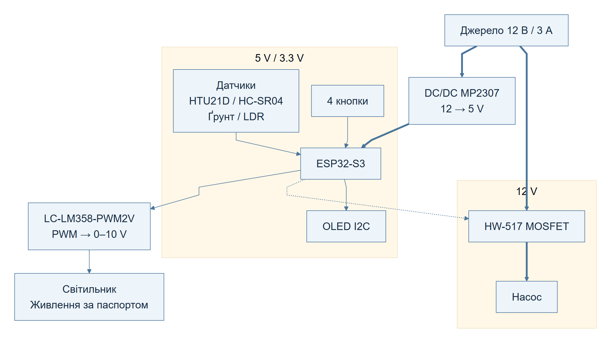
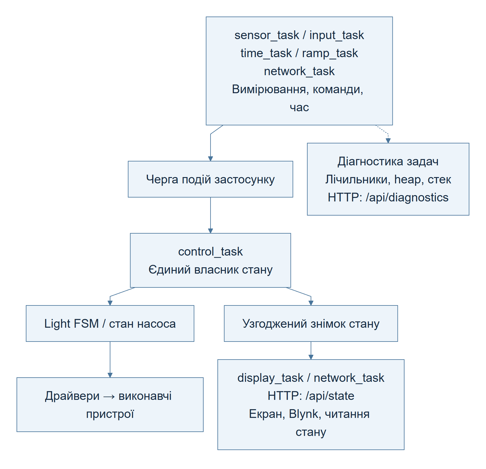
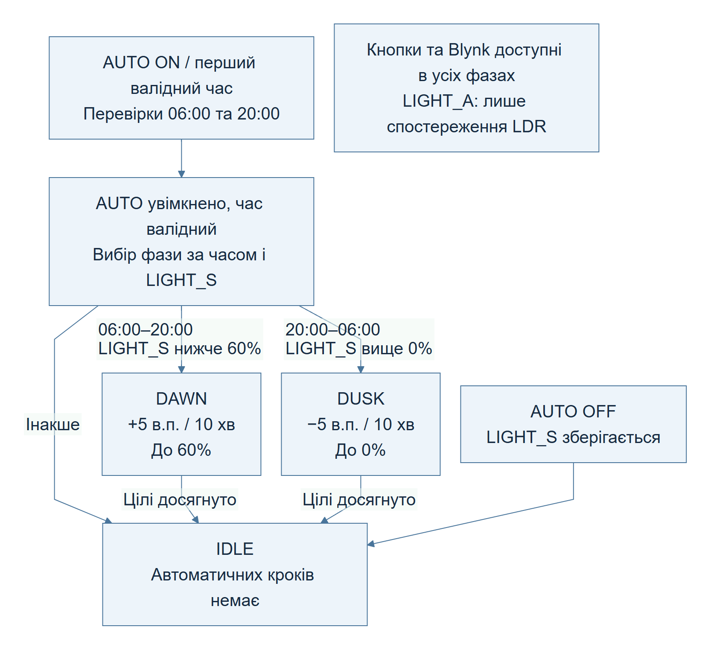
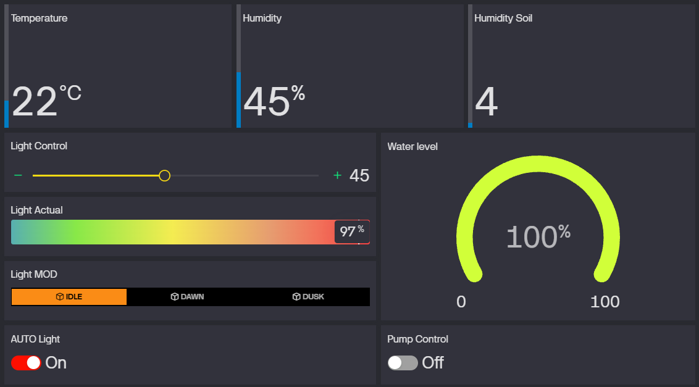
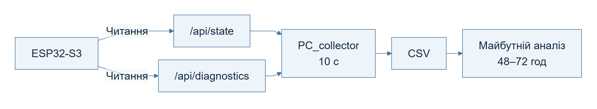

# GROW SYSTEM V0.2

Технічний опис прототипу

ESP32-S3 / FreeRTOS

## 1. Загальна інформація

GROW SYSTEM - прототип системи спостереження та керування простором для вирощування рослин. Він поєднує вимірювання параметрів середовища, керування насосом і освітленням, локальний екран та віддалений доступ через Blynk. Прошивка V0.2 працює на ESP32-S3 з ESP-IDF і FreeRTOS.

Документ описує пристрій і програмну архітектуру. Він не замінює електричну схему, посібник користувача чи протокол випробувань.

## 2. Призначення пристрою

Пристрій призначений для спостереження за температурою, вологістю повітря та субстрату, рівнем води й відносним освітленням. Користувач керує насосом і яскравістю кнопками або через Blynk, а також вмикає автоматичну зміну світлових фаз.

Насос керується вручну; автоматичний полив і профілі рослин не реалізовані. LDR використовується для спостереження і не коригує PWM. Відсоткові показання датчиків не означають незалежно підтвердженої точності вимірювань.

## 3. Основні функції

- Вимірювання HTU21D, ємнісного датчика ґрунту, HC-SR04 і LDR.
- Фільтрація відстані HC-SR04 та перерахунок у рівень води за заданими межами.
- Керування насосом і яскравістю 0–100%, чотири фізичні кнопки.
- Автоматичне керування освітленням: `IDLE`, `DAWN`, `DUSK`.
- Вісім полів на OLED; оновлення кожні 500 мс.
- Wi-Fi, синхронізація часу SNTP, команди й телеметрія Blynk.
- Локальні HTTP-знімки стану та діагностики; збирання CSV на ПК.

## 4. Апаратна частина

Таблиця 1 — Основні апаратні компоненти.

| Вузол | Компонент | Призначення |
| --- | --- | --- |
| Контролер | Waveshare ESP32-S3R2; 240 МГц; Flash 16 МБ | Обробка подій, вимірювань і зв'язку |
| Живлення | Джерело 12 В / 3 А | Живлення прототипу |
| DC/DC | MP2307-типу, 12 → 5 В | Живлення плати й логіки |
| Комутація насоса | HW-517, MOSFET | Увімкнення та вимкнення насоса |
| Керування світлом | LC-LM358-PWM2V | Перетворення PWM → 0–10 В |
| Температура / вологість | GY-21 / HTU21D | Вимірювання стану повітря |
| Ґрунт | Ємнісний датчик DFRobot | Оцінка вологості субстрату |
| Вода | HC-SR04 | Відстань до поверхні води |
| Світло | Аналоговий LDR | Відносне освітлення |
| Екран | OLED 0,96 дюйма, 128×64, I2C | Відображення стану |
| Кнопки | Чотири фізичні входи | Насос, AUTO, яскравість +/− |

Ґрунт і LDR використовують різні канали ADC1. HTU21D та OLED працюють на спільній шині I2C. Призначення виводів задані в `board_config.h`, періоди й калібрувальні межі - в `app_config.h`.

## 5. Структурна схема пристрою

Рисунок 1 — Апаратні блоки та розділення живлення.

Джерело 12 В живить силову гілку насоса та DC/DC. Вихід 5 В живить плату; логічна частина охоплює кола 5 В / 3,3 В. Товсті стрілки показують основні шляхи живлення, решта - сигнальні зв'язки. Таке розділення не означає гальванічної розв'язки.

Схема структурна: живлення окремих датчиків і перетворювача PWM не деталізовано. Живлення світильника визначається його паспортом, а не входом керування 0–10 В. Узгодження рівнів, спільні кола та захист навантажень належать до окремої електричної документації.

## 6. Програмна архітектура

Задачі вимірювань, кнопок, часу й мережі передають події в чергу подій застосунку. `control_task` - єдиний логічний власник стану застосунку та рішень щодо виконавчих пристроїв. Вона застосовує логіку світла й насоса, викликає драйвери та публікує стан.

Інші задачі отримують узгоджений знімок стану через `app_state_get_snapshot()`. Задача датчиків не керує PWM, мережа не перемикає насос безпосередньо. Вимірювання та мережеві запити виконуються поза обробниками керування.

У разі помилки датчика зберігається останнє коректне значення. Його оцінюють разом з ознакою валідності та кодом поточної помилки. Без мережі локальні команди, вимірювання й екран продовжують працювати; автоматичний вибір фази потребує валідного місцевого часу.

## 7. Архітектура взаємодії задач

Рисунок 2 — Події, керування, знімки стану та діагностика.

Таблиця 2 — Задачі FreeRTOS і періоди роботи.

| Задача | Призначення | Запуск / період |
| --- | --- | --- |
| `control_task` | Події та керування | Подія в черзі |
| `input_task` | Кнопки та усунення брязкоту | Опитування 10 мс за активності; брязкіт 40 мс |
| `sensor_task` | Вимірювання та публікація | 2 с |
| `display_task` | Знімок стану на OLED | 500 мс після стартового екрана |
| `network_task` | Обмін із Blynk | Опитування 5 с; телеметрія 5 с |
| `time_task` | Перевірка місцевого часу | 60 с |
| `ramp_task` | Подія кроку яскравості | 10 хв |

Опитування й телеметрія Blynk мають незалежні таймери. HTTP-сервер використовує задачу ESP-IDF. Лічильники оновлюють наявні модулі без окремої задачі діагностики. Вимкнена стара логіка в `main.c` не належить до активної архітектури.

## 8. Логіка керування освітленням

Таблиця 3 — Поля керування та спостереження.

| Поле | Значення |
| --- | --- |
| `LIGHT_S` | Заданий системою рівень, 0–100% |
| `LIGHT_A` | Показання LDR, 0–100%; не вимірювання в люксах |
| `AUTO` | Дозвіл автоматичного вибору фази |
| `MOD` | Стан `IDLE`, `DAWN` або `DUSK` |

У разі ввімкнення AUTO вдень, з 06:00 до 20:00, рівень нижче цілі 60% запускає DAWN. Уночі рівень вище нуля запускає DUSK. Якщо цільового рівня досягнуто, залишається IDLE. Без синхронізації пристрій чекає першого валідного часу й тоді визначає фазу.

Планові перевірки: DAWN о 06:00, DUSK о 20:00 місцевого часу, з перевіркою раз на хвилину. Фаза обирається без негайної зміни яскравості; наступна подія `APP_EVT_LIGHT_RAMP_TICK` змінює її на 5 відсоткових пунктів. Період кроку - 10 хвилин. Таймер незалежний від AUTO, тому перший крок може настати раніше повного інтервалу.

Рисунок 3 — Вибір фази та зміна заданої яскравості.

Кнопки й Blynk доступні під час DAWN/DUSK. Ручна команда зберігає напрямок циклу до його межі: за 60% або вище DAWN завершується без зниження яскравості; DUSK завершується за нуля. AUTO OFF зупиняє цикл і зберігає LIGHT_S. LDR слугує лише для спостереження; зворотного зв'язку LIGHT_A → PWM немає.

## 9. Інтеграція з Blynk

Таблиця 4 — Відповідність віртуальних пінів Blynk.

| Пін | Поле | Напрямок |
| --- | --- | --- |
| V0 | TEMP - температура | Пристрій → Blynk |
| V1 | HUM - вологість повітря | Пристрій → Blynk |
| V2 | SOIL - вологість ґрунту | Пристрій → Blynk |
| V3 | PUMP, 0/1 | Команда та стан |
| V4 | WATER - рівень води | Пристрій → Blynk |
| V5 | LIGHT_S, 0–100% | Команда та стан |
| V6 | LIGHT_A / LDR, 0–100% | Пристрій → Blynk |
| V7 | AUTO, 0/1 | Команда та стан |
| V8 | MOD: 0 IDLE, 1 DAWN, 2 DUSK | Лише телеметрія |

Рисунок 4 — Панель моніторингу та керування GROW SYSTEM у Blynk.

Панель поєднує телеметрію датчиків, заданий і виміряний рівні світла, стан автоматики, керування насосом та відображення води. Значення на знімку екрана ілюструють інтерфейс, а не результати випробування повної системи.

Сервіс використовує HTTPS. Опитування приймає V3, V5 і V7 та формує події застосунку; V8 - лише телеметрія. Надсилання публікує знімок без нових вимірювань. Незмінні значення та відлуння власного надсилання не повинні створювати повторні команди.

REST-обмін не атомарний: команду між читанням і записом стану може перезаписати наступне надсилання. Це обмеження поточної реалізації.

## 10. Діагностика та збирання даних

`/api/state` повертає стан виконавчих пристроїв, вимірювання, валідність і помилки датчиків. `/api/diagnostics` повертає uptime, лічильники подій і помилок, heap та запас стека. Локальні HTTP-інтерфейси доступні лише для читання; автентифікації у прототипі немає. Діагностика спостерігає за роботою пристрою окремо від звичайного керування.

Рисунок 5 — Шлях діагностичних даних до майбутнього аналізу.

Лічильники охоплюють цикли й помилки датчиків, тайм-аути HC-SR04, операції та помилки Blynk, спроби підключення Wi-Fi, переповнення черги, команди й кроки освітлення. `task_deadline_misses` враховує значні затримки задач sensor/display/time/ramp: перевищення періоду більше максимуму з 250 мс і 10% періоду. Це не вимірювач усіх можливих затримок.

Лічильники містяться в RAM і скидаються під час перезавантаження. Коротка критична секція захищає оновлення та копіювання; JSON формується поза нею. Uptime не залежить від SNTP. Heap охоплює поточну вільну пам'ять і мінімум від завантаження. Запас стека - мінімальний вільний залишок у байтах, який періодично зчитує задача, а не виділений розмір стека. `wifi_reconnects` охоплює початкову спробу підключення.

`PC_collector` за замовчуванням опитує обидва інтерфейси кожні 10 с і зберігає один рядок CSV на цикл: час, UTC-зміщення, прапорці успіху та значення. Запити послідовні, знімки не атомарні. За часткового збою доступні дані зберігаються, відсутні поля залишаються порожніми. Після рядка виконуються `flush()` і `fsync()`. Накопичувальних журналів у Flash і періодичних записів у NVS немає.

Інфраструктура готова до майбутнього повного випробування тривалістю 48–72 години; завершення такого випробування не заявляється. Повноцінний аналіз експлуатаційних даних буде виконано окремо після встановлення повної апаратної конфігурації в growbox. Результати тривалого прогону, графіки телеметрії та статистику діагностичних лічильників буде оформлено в окремому технічному звіті.

## 11. Поточний стан прототипу

Апаратний прототип, локальне керування, автоматичне освітлення, OLED та інтеграція Blynk працездатні на рівні прототипу. Архітектуру датчиків реалізовано; діагностика та PC_collector працюють. Це не підтвердження завершеної перевірки всієї апаратної конфігурації в growbox.

Раніше зібраний CSV отримано без участі датчика ґрунту та HC-SR04 у повноцінному випробуванні, без установленого світильника й повного світлового середовища growbox. Зміни LIGHT_S не дозволяють вважати LIGHT_A вимірюванням реального відгуку світильника. Числові результати цього прогону не включені до огляду й не використовуються для оцінки повної системи.

## 12. Висновок

GROW SYSTEM V0.2 поєднує вимірювання, локальні та віддалені команди в подієвій архітектурі з єдиним власником керувального стану. Окремі знімки стану й діагностики дають змогу спостерігати за поведінкою пристрою та готувати подальшу перевірку. Наступний етап валідації - випробування повної конфігурації в growbox з окремим технічним звітом.
