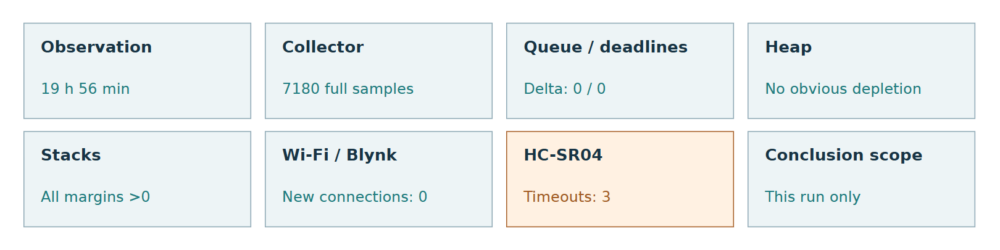
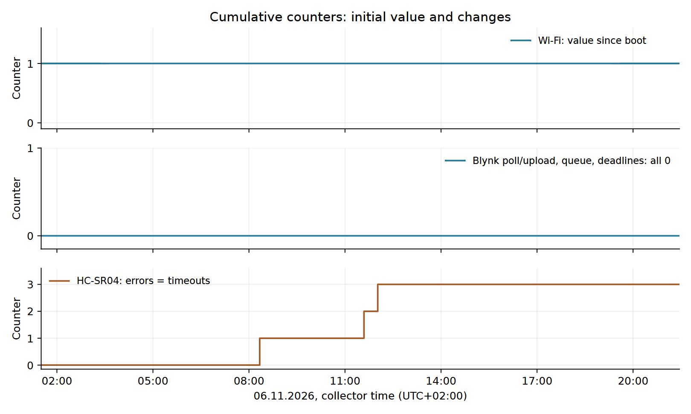
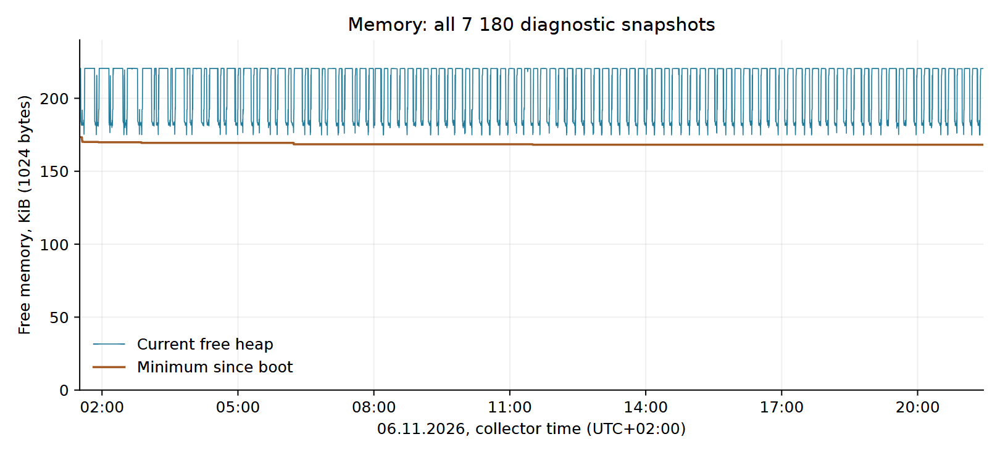
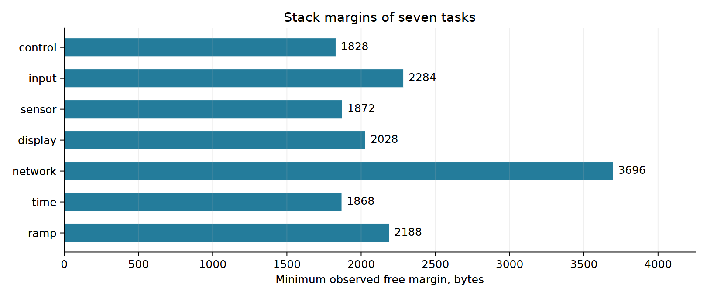
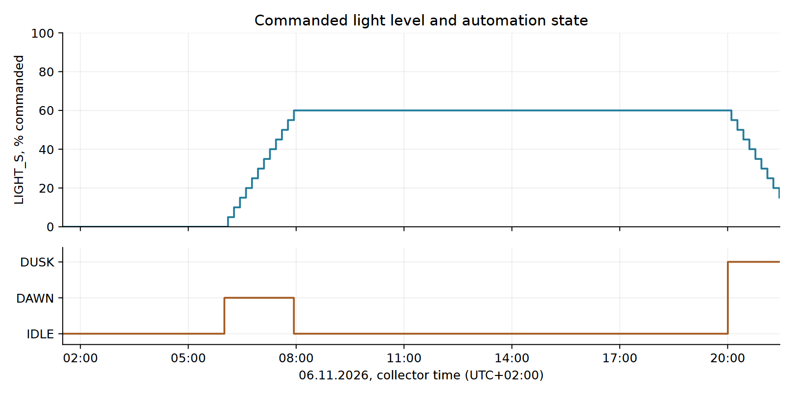

# GROW SYSTEM V0.2

## Continuous Endurance Test and System Health Report

ESP32-S3 / FreeRTOS

06 November 2026

**Observed interval: 19 h 56 min 32.297 s.**

The prototype continued acquiring data, communicating with Blynk and automatically adjusting lighting. No reboot, recorded event queue overflow or monitored task deadline miss is visible in the log. Transient HC-SR04 timeouts occurred without an observed application stoppage.

**Scope of the conclusion:** stability is supported only within this specific run. Sensor accuracy, agronomic effectiveness and industrial reliability are not evaluated.

Source: `PC_collector/2026-11-06_01-30.csv`

Branch: `develop/firmware-v0.2-rtos`

Evidence: the complete CSV, 7 180 rows; the original file was not modified.

The analysis and figures can be reproduced using the saved Python scripts. This is a derived report, not a replacement for the original log.

Figure 1. Summary of observations. Network recovery was not tested.

<!-- pagebreak -->

## 1. Purpose, configuration and methodology

The central question is how stably GROW SYSTEM V0.2 operated as a hardware/software system during the continuous test run. The assessment covers detectable signs of faults, observation continuity and operation of the task architecture.

Sensor readings are used only to evaluate continuity of data acquisition and stability of hardware/software interaction. Measurement accuracy is not evaluated: final sensor calibration is a separate stage.

### Test configuration

According to the test description, the complete ESP32-S3 prototype was running V0.2 firmware. `sensor_task`, `input_task`, `time_task`, `ramp_task` and `network_task` produce events; `control_task` owns the logical actuator state. `display_task` presents snapshots on the OLED. Local controls are provided, but their active use was not recorded in this log.

The HTTP server provides `/api/state` and `/api/diagnostics`. PC_collector polls them sequentially approximately every 10 s. Each row's timestamp marks the start of polling; the two responses are not one atomic snapshot. Uptime is measured on the ESP32 independently of SNTP.

### Data processing

All 7 180 rows and all 60 columns were read. Structure, types, missing values, consistency of local/epoch/UTC offset and cumulative collector totals were checked. Rows were not sorted, discarded or interpolated. Counter delta = final minus initial value; decreases and times of increases were checked separately.

The 2 s sensor period is confirmed by `src/config/app_config.h`. Metric semantics were cross-checked against `docs/device-overview-ru.md`, `README.md` and the diagnostics, sensor_task, network_service and collector implementations. Repository revision at the start of analysis: `ee77b22c486c6af08d0b24dc068625c888cd626b`; the CSV does not identify the binary actually flashed to the device.

### Contents

| Section | Page |
| --- | --- |
| Purpose, configuration and methodology | 2 |
| Data completeness and overall assessment | 3 |
| Queue, tasks, uptime and network | 4 |
| Heap behaviour | 5 |
| Task stack margins | 6 |
| Sensors and cycle continuity | 7 |
| Automation and control events | 8 |
| Limitations, conclusion and reproducibility | 9 |

<!-- pagebreak -->

## 2. Data completeness and overall assessment

Table 1. Observation interval and quality.

| Metric | Result |
| --- | --- |
| Start, UTC+02:00 | 06.11.2026 01:30:28.744 |
| End, UTC+02:00 | 06.11.2026 21:27:01.041 |
| Duration | 19 h 56 min 32.297 s |
| Rows / expected at 10 s | 7 180 / approximately 7 180 |
| Full / partial / failed samples | 7 180 / 0 / 0 |
| Interval: minimum / median / maximum | 10 / 10 / 10.001 s |
| Intervals >15 s | 0 |

request_ok, state_request_ok and diagnostics_request_ok equal 1 in every row; collector_error is empty. Final cumulative totals agree with the row-by-row count. The 15 s threshold is used only to identify noticeable gaps in this analysis, not as a system requirement. No significant gaps are visible at the normal interval of approximately 10 s.

Table 2. Subsystem health over the observed interval, without a numerical health score.

| Subsystem | Assessment | Observation |
| --- | --- | --- |
| Collector | Stable | 7 180 full samples; no losses visible |
| Queue / deadlines | No recorded faults | Both counters remain 0 |
| Uptime | Continuous | No resets or backward jumps |
| Heap | No obvious depletion | Fluctuations with recovery of free memory |
| Stacks | No zero margin observed | Minima for the seven tasks remain positive |
| Wi-Fi / Blynk | Stable | No new connection attempts or Blynk errors |
| HTU21 / soil / LDR | No recorded errors | Data acquisition continued |
| HC-SR04 | Transient errors | 3 timeouts; application operation continued |
| Synchronization | Flag retained | time_synced=True in every row |

The initial estimate of approximately 19 h 57 min is refined to 19 h 56 min 32.297 s. Wi-Fi=1 does not mean one connection loss within this interval: the counter delta is 0.

<!-- pagebreak -->

## 3. Queue, tasks, uptime and network

Queue overflows and task_deadline_misses: initial 0, final 0, delta 0. Deadline monitoring covers sensor/display/time/ramp and records a period overrun greater than max(250 ms, 10% of the period). This is not a hard real-time guarantee or a measurement of every delay in every task.

Uptime increased from 249 to 72 043 s, without resets or repeated values. Increments of 9-11 s are consistent with discrete snapshots. The difference between the uptime delta and collector duration is 1.703 s; the clocks and sampling instants differ. No reboot is visible in this interval.

Table 3. Network and synchronization: cumulative values.

| Metric | Initial | Final | Delta |
| --- | --- | --- | --- |
| Wi-Fi connection attempts | 1 | 1 | 0 |
| Successful Blynk polls | 50 | 14 354 | 14 304 |
| Blynk poll errors | 0 | 0 | 0 |
| Successful Blynk uploads | 50 | 14 353 | 14 303 |
| Blynk upload errors | 0 | 0 | 0 |
| Synchronization events | 1 | 1 | 0 |

Wi-Fi is connected and time_synced=True in all 7 180 snapshots. `wifi_reconnects` includes the initial attempt; the value 1 was already present before recording began. Reconnection and recovery after Wi-Fi loss were not tested by this run.

Figure 2. All counter snapshots. The zero lines for Blynk, the queue and deadlines coincide and are shown as one explicitly labelled line. HC-SR04 errors and timeouts refer to the same events and are not added together.

<!-- pagebreak -->

## 4. Free memory behaviour

Figure 3. Current free heap and minimum since boot. All points are retained without smoothing; the axis starts at zero. The chart uses KiB = 1024 bytes.

Table 4. Main heap characteristics.

| Metric | Bytes | KiB |
| --- | --- | --- |
| Current: initial | 225 824 | 220.53 |
| Current: final | 225 672 | 220.38 |
| Current: minimum | 179 016 | 174.82 |
| Current: maximum | 225 856 | 220.56 |
| Minimum since boot: initial | 177 636 | 173.47 |
| Minimum since boot: final | 172 220 | 168.18 |

Final current free heap is 152 bytes below its initial value. The medians of the first and last hourly windows are 225824 and 225664 bytes. Repeated brief decreases are followed by recovery to a similar upper level. The linear estimate over all points is 4.53 bytes/h; this is descriptive, not proof that no leak exists.

The minimum since boot decreased by 5 416 bytes across 12 updates; the last decrease is first visible at 11:30:19. It remained unchanged thereafter. By definition, this metric cannot increase and includes events before the first snapshot. Its minimum is lower than the minimum current free heap in the CSV because deeper brief allocations can occur between polls.

**Conclusion:** sustained depletion of available memory is not visible in the observed interval. A small baseline change is present; this test does not prove the absence of all slow leaks, fragmentation or future allocation failures. The exact minima refine the initial estimates: 179 016 bytes and 172 220 bytes, rather than the rounded “179/172 KB”.

<!-- pagebreak -->

## 5. Task stack margins

stack_*_bytes is the minimum free stack margin observed by a task during its lifetime and periodically published by diagnostics. It is not current stack depth or allocated stack size. A decrease reflects a new peak in usage, not necessarily a leak.

Figure 4. Minima across the entire CSV. The zero baseline is retained; no threshold for a “safe” size is introduced.

Table 5. Stacks of the seven monitored tasks.

| Task | Initial, bytes | Minimum, bytes | Observation |
| --- | --- | --- | --- |
| control | 1 828 | 1 828 | Unchanged |
| input | 2 284 | 2 284 | Unchanged |
| sensor | 2 624 | 1 872 | New minimum, >0 |
| display | 2 028 | 2 028 | Unchanged |
| network | 3 792 | 3 696 | New minimum, >0 |
| time | 1 868 | 1 868 | Unchanged |
| ramp | 2 556 | 2 188 | New minimum, >0 |

The smallest margin among the tasks is 1 828 bytes for control_task. None of the seven metrics approached zero in the observed values. The sensor_task minimum decreased at the first HC-SR04 timeout; the timing is consistent with error handling, but does not prove its exact contribution to stack depth.

**Conclusion:** stack exhaustion is not visible in the monitored metrics. Without examining all execution paths and allocated stack sizes, these margins cannot be declared universally safe. The stacks of HTTP, system tasks and other tasks not listed here are not covered by this metric set.

<!-- pagebreak -->

## 6. Sensors and cycle continuity

Table 6. Data availability and communication errors, not measurement accuracy.

| Sensor | valid=True | Errors: initial → final | Observation |
| --- | --- | --- | --- |
| HTU21 | 7 180/7 180 | 0 → 0 (+0) | No recorded errors |
| Soil | 7 180/7 180 | 0 → 0 (+0) | No recorded errors |
| LDR | 7 180/7 180 | 0 → 0 (+0) | No recorded errors |
| HC-SR04 | 7 180/7 180 | 0 → 3 (+3) | Timeouts; operation continued |

All current sensor_error fields are 0 in the snapshots. However, valid indicates that a correct result has been retained: an error does not necessarily clear this flag. Therefore, valid=True does not prove that every measurement succeeded. The HTTP polling period of approximately 10 s can miss an individual error between snapshots; cumulative counters retain such events.

### HC-SR04 timeouts

Table 7. Detection windows for ultrasonic_timeouts increments; collector time UTC+02:00.

| Previous poll | First poll with increment | Delta |
| --- | --- | --- |
| 08:19:59 | 08:20:09 | 1 |
| 11:35:29 | 11:35:39 | 1 |
| 12:01:20 | 12:01:30 | 1 |

The exact event time within each window is not recorded; the HTTP response was received after the poll-start timestamp. Windows are displayed with one-second precision. Both counters increased identically: ultrasonic_errors and ultrasonic_timeouts rose from 0 to 3. These are 3 errors, not the sum of two counters.

`sensor_task` rejects invalid ultrasonic readings. The filter retains its previous history and valid result. After all events, uptime, sensor_cycles and successful Blynk operations continued increasing, while the collector continued receiving full responses. No application destabilization is observed. The CSV does not establish the cause of the timeouts.

### sensor_task continuity

The cycle count increased from 123 to 36 020: a delta of 35 897. Uptime delta / 2 s = 35897 cycles. This agreement is consistent with SENSOR_PERIOD_MS=2000; 4-6 cycles are observed between consecutive HTTP snapshots.

Timeouts account for approximately 0.0084% of the cycle-count delta. This is only the fraction of recorded errors in this run, not an estimate of failure probability or measurement accuracy. Absolute temperature, humidity, soil, water and LDR readings are not used for agronomic conclusions.

<!-- pagebreak -->

## 7. Automation and control events

AUTO=1 in every snapshot. Recorded transitions are 06:00:19 IDLE → DAWN, 07:56:19 DAWN → IDLE, and 20:00:20 IDLE → DUSK. These are first-observation times, not exact firmware command times.

Figure 5. LIGHT_S is the commanded level; MOD is the automation phase. LIGHT_A is available in the log but is not used as calibrated photometry or proof of grow-light operation.

LIGHT_S rose from 0 to 60%, then fell to 15% by the end of recording. There were 21 changes of 5 percentage points. The morning rise completed; the evening DUSK phase was still in progress, and this log does not confirm reaching 0%.

Table 8. Control counters.

| Metric | Initial | Final | Delta |
| --- | --- | --- | --- |
| Ramp timer events | 0 | 120 | 120 |
| Applied ramp steps | 0 | 21 | 21 |
| Button events | 0 | 0 | 0 |
| Pump commands | 0 | 0 | 0 |
| Manual light commands | 0 | 0 | 0 |
| AUTO commands | 1 | 1 | 0 |

The pump remained off. Buttons and manual commands were not exercised during this interval; the initial AUTO command preceded observation. The run therefore supports timer-event processing and recording of automatic lighting state, but does not test pump switching, button response or mixed manual and automatic commands. Successful Blynk polls are not equivalent to executed user commands.

<!-- pagebreak -->

## 8. Limitations and conclusion

### What this test does not establish

- Sensors have not completed final calibration; accuracy of absolute readings was not evaluated.
- The test assesses runtime system behaviour, not growing quality, irrigation effectiveness or light sufficiency.
- This is one prototype, one configuration and one interval of 19 h 56 min 32.297 s, shorter than the planned 48-72 hours.
- The first snapshot starts at uptime=249 s: initial boot was not observed. The absence of new Wi-Fi connections does not test network recovery.
- Discrete responses every 10 s and a limited metric set do not detect every possible brief fault. Deadline counters cover only four tasks.
- The pump and manual control events were not activated. LIGHT_S does not prove physical output power or photometric characteristics of the grow light.
- Industrial reliability requires longer runs and separate fault, load and recovery scenarios. The CSV does not specify the binary actually flashed to the device.

### Overall assessment

For 19 h 56 min 32.297 s, the collector continuously received complete data. No reboot, queue overflow, recorded task deadline miss or Blynk error was observed. Memory showed no obvious progressive depletion; all seven monitored stacks retained positive margins. Automatic lighting processed DAWN and DUSK events.

There were 3 HC-SR04 timeouts. They must not be hidden behind valid=True flags or described as error-free operation. Data acquisition and application operation continued after these events, supporting robustness against these observed transient sensor errors. Network recovery was not tested: wifi_reconnects remained at 1 with no increase.

**The results support stability of the current prototype within this specific test run, but do not establish sensor measurement accuracy or industrial reliability.**

### Traceability and reproduction

Source log: `PC_collector/2026-11-06_01-30.csv`. SHA-256:

`354bc2eaae899579d62f068fd749548b`

`d33540cdb200794e72f751ce7e09c5f4`

The two lines above form one 64-character hash without spaces. Derived files: `summary.json`, `assets/`, this Markdown and PDF. `analyze_endurance.py` reads the complete log, validates data and creates metrics/figures; `write_report.py` generates editable text; `build_pdf.py` builds the PDF from Markdown. The original CSV is not rewritten. Commands and dependencies are provided in this directory's README.
