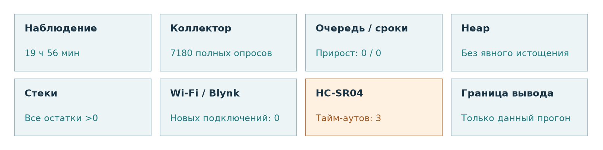
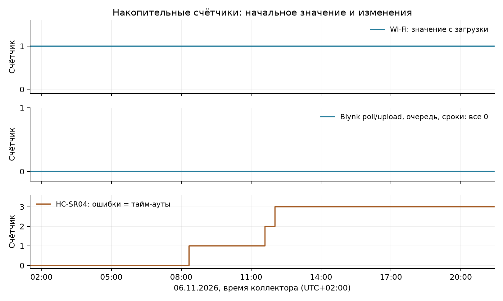
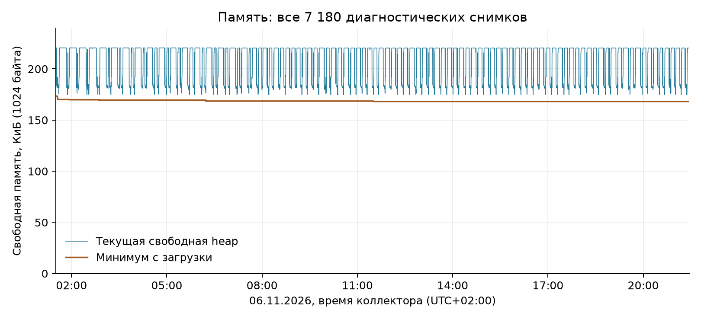
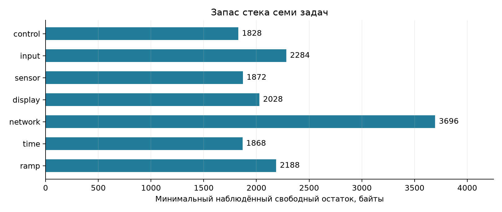
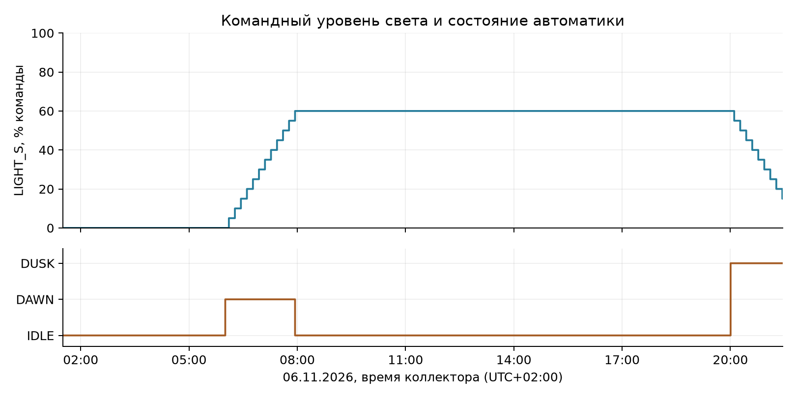

# GROW SYSTEM V0.2

## Отчёт о непрерывном тестировании и состоянии системы

ESP32-S3 / FreeRTOS

06 ноября 2026 года

**Наблюдаемый интервал: 19 ч 56 мин 32,297 с.**

Прототип продолжал выполнять сбор данных, обмен с Blynk и автоматическое изменение света. Перезагрузок, зарегистрированных переполнений очереди и пропусков контролируемых сроков задач в логе не видно. Обнаружены кратковременные тайм-ауты HC-SR04, без наблюдаемой остановки приложения.

**Граница вывода:** стабильность подтверждается только в пределах данного прогона. Точность датчиков, агрономический эффект и промышленная надёжность не оцениваются.

Источник: `PC_collector/2026-11-06_01-30.csv`

Ветка: `develop/firmware-v0.2-rtos`

Основание: полный CSV, 7 180 строк; исходный файл не изменялся.

Анализ и графики воспроизводятся сохранёнными Python-скриптами. Это производный отчёт, а не замена исходного журнала.

Рисунок 1. Сводка наблюдений. Сетевое восстановление не проверялось.

<!-- pagebreak -->

## 1. Цель, конфигурация и методика

Главный вопрос: насколько стабильно GROW SYSTEM V0.2 работал как программно-аппаратная система во время непрерывного тестового прогона? Проверяются диагностируемые признаки отказов, непрерывность наблюдения и работа архитектуры задач.

Показания датчиков используются для оценки непрерывности сбора данных и стабильности программно-аппаратного взаимодействия. Метрологическая оценка значений не выполняется: окончательная калибровка сенсоров является отдельным этапом.

### Испытуемая конфигурация

По описанию испытания работал полный прототип ESP32-S3 с прошивкой V0.2. `sensor_task`, `input_task`, `time_task`, `ramp_task` и `network_task` формируют события; `control_task` владеет логическим состоянием исполнительных узлов. `display_task` выводит снимки на OLED. Локальные органы управления предусмотрены, но их активное использование в данном логе не зафиксировано.

HTTP-сервер отдаёт `/api/state` и `/api/diagnostics`. PC_collector опрашивает их последовательно примерно раз в 10 с. Временная метка строки относится к началу опроса; два ответа не являются одним атомарным снимком. Uptime измеряется на ESP32 независимо от SNTP.

### Как обработаны данные

Прочитаны все 7 180 строк и все 60 столбцов. Проверены структура, типы, отсутствующие значения, согласованность local/epoch/UTC offset и накопительные итоги коллектора. Строки не сортировались, не отбрасывались и не интерполировались. Прирост счётчика = конец минус начало; отдельно проверены уменьшения и моменты роста.

Период датчиков 2 с подтверждён `src/config/app_config.h`. Семантика метрик сверена с `docs/device-overview-ru.md`, `README.md` и реализацией diagnostics, sensor_task, network_service и коллектора. Ревизия репозитория на начало анализа: `ee77b22c486c6af08d0b24dc068625c888cd626b`; CSV не содержит идентификатор реально прошитого бинарного файла.

### Содержание

| Раздел | Страница |
| --- | --- |
| Цель, конфигурация и методика | 2 |
| Полнота данных и общая оценка | 3 |
| Очередь, задачи, uptime и сеть | 4 |
| Поведение heap | 5 |
| Запас стека задач | 6 |
| Датчики и непрерывность циклов | 7 |
| Автоматика и управляющие события | 8 |
| Ограничения, вывод и воспроизводимость | 9 |

<!-- pagebreak -->

## 2. Полнота данных и общая оценка

Таблица 1. Интервал и качество наблюдения.

| Показатель | Результат |
| --- | --- |
| Начало, UTC+02:00 | 06.11.2026 01:30:28.744 |
| Конец, UTC+02:00 | 06.11.2026 21:27:01.041 |
| Длительность | 19 ч 56 мин 32,297 с |
| Строк / ожидаемо при 10 с | 7 180 / около 7 180 |
| Полных / частичных / неудачных опросов | 7 180 / 0 / 0 |
| Интервал: минимум / медиана / максимум | 10 / 10 / 10,001 с |
| Интервалы >15 с | 0 |

У всех строк request_ok, state_request_ok и diagnostics_request_ok равны 1; поле collector_error пустое. Итоговые накопительные значения согласованы с построчным подсчётом. Порог 15 с выбран только для обнаружения заметных промежутков в этом анализе, а не как норматив системы. При нормальном шаге около 10 с существенных пропусков не видно.

Таблица 2. Состояние подсистем за наблюдаемый интервал (без численного «рейтинга здоровья»).

| Подсистема | Оценка | Наблюдение |
| --- | --- | --- |
| Коллектор | Стабильно | 7 180 полных опросов; потерь не видно |
| Очередь / сроки | Без записанных сбоев | Оба счётчика остаются 0 |
| Uptime | Непрерывно | Сбросов и обратных скачков нет |
| Heap | Без явного истощения | Колебания с восстановлением свободной памяти |
| Стеки | Нулевой запас не наблюдался | Минимумы семи задач положительны |
| Wi-Fi / Blynk | Стабильно | Новых попыток подключения и ошибок Blynk нет |
| HTU21 / почва / LDR | Без записанных ошибок | Сбор данных продолжался |
| HC-SR04 | Переходные ошибки | 3 тайм-аута; приложение продолжило работу |
| Синхронизация | Флаг сохранялся | time_synced=True во всех строках |

Начальные оценки «около 19 ч 57 мин» уточнены до 19 ч 56 мин 32,297 с. Значение Wi-Fi=1 не означает один разрыв связи внутри этого интервала: прирост равен 0.

<!-- pagebreak -->

## 3. Очередь, задачи, uptime и сеть

Переполнения очереди и task_deadline_misses: начало 0, конец 0, прирост 0. Этот контроль сроков охватывает sensor/display/time/ramp и фиксирует превышение периода более чем на max(250 мс, 10% периода). Это не гарантия жёсткого реального времени и не измерение всех задержек всех задач.

Uptime вырос с 249 до 72 043 с, без сбросов и повторов. Шаги 9-11 с соответствуют дискретным снимкам. Разница между приростом uptime и длительностью коллектора - 1,703 с; часы и моменты выборки различаются. Перезагрузка в этом интервале не видна.

Таблица 3. Сеть и синхронизация: накопительные значения.

| Показатель | Начало | Конец | Прирост |
| --- | --- | --- | --- |
| Попытки подключения Wi-Fi | 1 | 1 | 0 |
| Успешные Blynk poll | 50 | 14 354 | 14 304 |
| Ошибки Blynk poll | 0 | 0 | 0 |
| Успешные Blynk upload | 50 | 14 353 | 14 303 |
| Ошибки Blynk upload | 0 | 0 | 0 |
| События синхронизации | 1 | 1 | 0 |

Wi-Fi подключён и time_synced=True во всех 7 180 снимках. `wifi_reconnects` включает первоначальную попытку; значение 1 существовало до начала записи. Повторное подключение и восстановление после потери Wi-Fi данным прогоном не проверены.

Рисунок 2. Все снимки счётчиков. Нулевые линии Blynk, очереди и сроков совпадают; показаны одной линией с явной подписью. Ошибки HC-SR04 и тайм-ауты относятся к одним событиям, а не суммируются.

<!-- pagebreak -->

## 4. Поведение свободной памяти

Рисунок 3. Текущая свободная heap и минимум с загрузки. Все точки сохранены, сглаживание не применяется; ось начинается с нуля. На графике КиБ = 1024 байта.

Таблица 4. Основные характеристики heap.

| Метрика | Байты | КиБ |
| --- | --- | --- |
| Текущая: начало | 225 824 | 220,53 |
| Текущая: конец | 225 672 | 220,38 |
| Текущая: минимум | 179 016 | 174,82 |
| Текущая: максимум | 225 856 | 220,56 |
| Минимум с загрузки: начало | 177 636 | 173,47 |
| Минимум с загрузки: конец | 172 220 | 168,18 |

Конечная текущая heap ниже начальной на 152 байта. Медиана первого и последнего часового окна: 225824 и 225664 байта. Видны повторяющиеся кратковременные снижения с возвратом к близкому верхнему уровню. Линейная оценка по всем точкам: 4,53 байта/ч; это описательная оценка, не доказательство отсутствия утечки.

Минимум с загрузки снизился на 5 416 байта за 12 обновлений; последнее снижение впервые видно в 11:30:19. После этого значение не изменялось. Эта метрика по определению не растёт и включает события до первого снимка. Её минимум ниже минимальной текущей heap в CSV, поскольку между опросами возможны более глубокие краткие выделения.

**Вывод:** устойчивого истощения доступной памяти в наблюдаемом интервале не видно. Небольшое изменение базового уровня присутствует; отсутствие любых медленных утечек, фрагментации или будущего отказа выделения памяти этим тестом не доказано. Точные минимумы уточняют исходные ориентиры: 179 016 байт и 172 220 байт, а не округлённые «179/172 КБ».

<!-- pagebreak -->

## 5. Запас стека задач

Метрика stack_*_bytes - минимальный свободный остаток, замеченный задачей за время жизни и периодически опубликованный диагностикой. Это не текущая глубина стека и не выделенный размер. Снижение отражает новый максимум использования, а не обязательно утечку.

Рисунок 4. Минимумы по всему CSV. Нулевая база сохранена; порог «безопасного» размера не вводится.

Таблица 5. Стек семи контролируемых задач.

| Задача | Начало, байт | Минимум, байт | Наблюдение |
| --- | --- | --- | --- |
| control | 1 828 | 1 828 | Без изменения |
| input | 2 284 | 2 284 | Без изменения |
| sensor | 2 624 | 1 872 | Новый минимум, >0 |
| display | 2 028 | 2 028 | Без изменения |
| network | 3 792 | 3 696 | Новый минимум, >0 |
| time | 1 868 | 1 868 | Без изменения |
| ramp | 2 556 | 2 188 | Новый минимум, >0 |

Наименьший остаток среди задач: 1 828 байта у control_task. Ни одна из семи метрик не приблизилась к нулю в наблюдаемых значениях. Для sensor_task минимум снизился при первом тайм-ауте HC-SR04; совпадение времени согласуется с обработкой ошибки, но не доказывает её точный вклад в глубину стека.

**Вывод:** исчерпания стека в контролируемых метриках не видно. Без анализа всех путей выполнения и исходных размеров стеков нельзя объявить эти остатки универсальным запасом безопасности. Стеки HTTP, системных и других не перечисленных задач данным набором метрик не покрыты.

<!-- pagebreak -->

## 6. Датчики и непрерывность циклов

Таблица 6. Доступность данных и ошибки обмена (не точность измерений).

| Датчик | valid=True | Ошибки: начало → конец | Наблюдение |
| --- | --- | --- | --- |
| HTU21 | 7 180/7 180 | 0 → 0 (+0) | Нет записанных ошибок |
| Почва | 7 180/7 180 | 0 → 0 (+0) | Нет записанных ошибок |
| LDR | 7 180/7 180 | 0 → 0 (+0) | Нет записанных ошибок |
| HC-SR04 | 7 180/7 180 | 0 → 3 (+3) | Тайм-ауты, работа продолжилась |

Все текущие поля sensor_error в снимках равны 0. Однако valid означает наличие сохранённого корректного результата: при ошибке этот флаг не обязательно сбрасывается. Поэтому valid=True не доказывает успешность каждого измерения. Период HTTP-опроса около 10 с может скрывать отдельную ошибку между снимками; накопительные счётчики сохраняют такие события.

### Тайм-ауты HC-SR04

Таблица 7. Окна обнаружения прироста ultrasonic_timeouts; время коллектора UTC+02:00.

| Предыдущий опрос | Первый опрос с приростом | Прирост |
| --- | --- | --- |
| 08:19:59 | 08:20:09 | 1 |
| 11:35:29 | 11:35:39 | 1 |
| 12:01:20 | 12:01:30 | 1 |

Точное время события внутри каждого окна не записано; HTTP-ответ получен после метки начала опроса. Окна приведены с точностью до секунды. Оба счётчика выросли одинаково: ultrasonic_errors и ultrasonic_timeouts с 0 до 3. Это 3 ошибок, а не сумма двух счётчиков.

`sensor_task` отбрасывает ошибочное ультразвуковое чтение. Фильтр сохраняет предыдущую историю и корректный результат. После всех событий росли uptime, sensor_cycles и успешные операции Blynk, а коллектор продолжал получать полные ответы. Наблюдаемой дестабилизации приложения нет. Причина тайм-аутов по CSV не устанавливается.

### Непрерывность sensor_task

Число циклов выросло с 123 до 36 020: прирост 35 897. Прирост uptime / 2 с = 35897 циклов. Совпадение согласуется с SENSOR_PERIOD_MS=2000; между соседними HTTP-снимками наблюдается 4-6 циклов.

Тайм-ауты составляют около 0.0084% от прироста циклов. Это лишь доля зарегистрированных ошибок в этом прогоне, не оценка вероятности отказа или метрологической точности. Абсолютные температура, влажность, почва, вода и LDR не используются для агрономических выводов.

<!-- pagebreak -->

## 7. Автоматика и управляющие события

AUTO=1 во всех снимках. Зафиксированы переходы 06:00:19 IDLE → DAWN, 07:56:19 DAWN → IDLE, 20:00:20 IDLE → DUSK. Это время первого наблюдения, а не точный момент команды в прошивке.

Рисунок 5. LIGHT_S - командный уровень, MOD - фаза автоматики. LIGHT_A доступен в логе, но не используется как калиброванная фотометрия или доказательство работы светильника.

LIGHT_S вырос от 0 до 60%, затем снизился до 15% к концу записи. Зафиксировано 21 изменение на 5 процентных пунктов. Утренний подъём завершён; вечерний DUSK ещё продолжался, достижение 0% этим логом не подтверждено.

Таблица 8. Счётчики управления.

| Показатель | Начало | Конец | Прирост |
| --- | --- | --- | --- |
| События таймера ramp | 0 | 120 | 120 |
| Применённые шаги ramp | 0 | 21 | 21 |
| События кнопок | 0 | 0 | 0 |
| Команды насоса | 0 | 0 | 0 |
| Ручные команды света | 0 | 0 | 0 |
| Команды AUTO | 1 | 1 | 0 |

Насос оставался выключенным. Кнопки и ручные команды в этом интервале не упражнялись; начальная команда AUTO поступила до начала наблюдения. Поэтому прогон подтверждает обработку таймерных событий и запись состояния автоматического света, но не тестирует переключения насоса, реакцию на кнопки или смешанные ручные и автоматические команды. Успешные опросы Blynk не равнозначны выполненным пользовательским командам.

<!-- pagebreak -->

## 8. Ограничения и итог

### Что испытание не подтверждает

- Датчики ещё не прошли окончательную калибровку; точность абсолютных показаний не оценивалась.
- Проверяется runtime-поведение системы, а не качество выращивания, эффективность полива или достаточность света.
- Это один прототип, одна конфигурация и один интервал 19 ч 56 мин 32,297 с; он короче планируемых 48-72 часов.
- Первый снимок начинается с uptime=249 с: начальная загрузка не наблюдалась. Отсутствие новых Wi-Fi-подключений не проверяет восстановление сети.
- Дискретные ответы раз в 10 с и ограниченный набор метрик не обнаруживают все возможные краткие сбои. Счётчики сроков охватывают только четыре задачи.
- Насос и ручные управляющие события не активировались. Состояние LIGHT_S не доказывает физическую мощность или фотометрические характеристики светильника.
- Для промышленной надёжности нужны более длительные прогоны и отдельные сценарии отказов, нагрузки и восстановления. Версия реально прошитого бинарного файла в CSV не указана.

### Итоговая оценка

В течение 19 ч 56 мин 32,297 с коллектор непрерывно получал полные данные. Перезагрузка, переполнение очереди, зарегистрированный пропуск сроков и ошибка Blynk не наблюдались. Память не демонстрировала явного прогрессирующего истощения; все семь контролируемых стеков сохранили положительный остаток. Автоматический свет обрабатывал события DAWN и DUSK.

Обнаружены 3 тайм-аута HC-SR04. Их нельзя скрывать за флагами valid=True или называть работой без ошибок. После событий сбор данных и работа приложения продолжились, что подтверждает устойчивость к этим наблюдавшимся переходным ошибкам датчика. Сетевое восстановление не проверено: wifi_reconnects оставался 1 без прироста.

**Полученные результаты подтверждают стабильность текущего прототипа в рамках проведённого испытания, но не подтверждают метрологическую точность датчиков или промышленную надёжность.**

### Прослеживаемость и воспроизведение

Исходный журнал: `PC_collector/2026-11-06_01-30.csv`. SHA-256:

`354bc2eaae899579d62f068fd749548b`

`d33540cdb200794e72f751ce7e09c5f4`

Две строки выше образуют один 64-символьный хеш без пробелов. Производные файлы: `summary.json`, `assets/`, этот Markdown и PDF. `analyze_endurance.py` читает весь журнал, проверяет данные и создаёт метрики/графики; `write_report.py` формирует редактируемый текст; `build_pdf.py` собирает PDF из Markdown. Исходный CSV не переписывается. Команды и зависимости приведены в README этого каталога.
