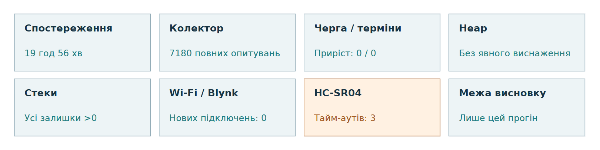
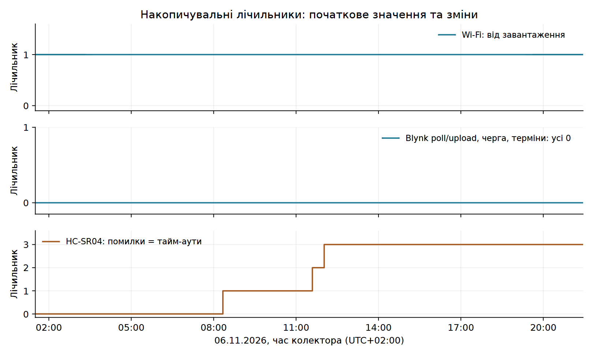
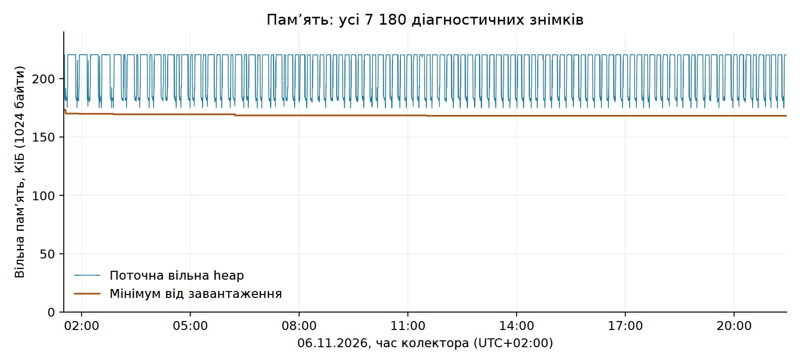
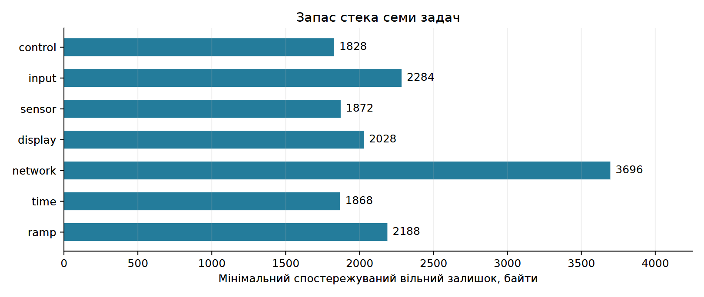
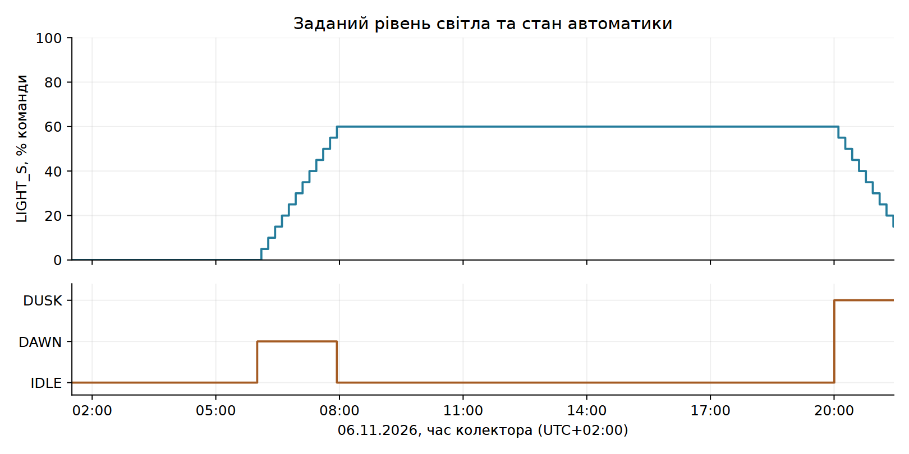

# GROW SYSTEM V0.2

## Звіт про безперервне тестування та стан системи

ESP32-S3 / FreeRTOS

06 листопада 2026 року

**Спостережуваний інтервал: 19 год 56 хв 32,297 с.**

Прототип продовжував збирати дані, обмінюватися ними з Blynk та автоматично змінювати освітлення. Перезавантажень, зареєстрованих переповнень черги подій і пропусків контрольованих термінів задач у журналі не видно. Виявлено короткочасні тайм-аути HC-SR04 без спостережуваної зупинки застосунку.

**Межа висновку:** стабільність підтверджується лише в межах цього прогону. Точність датчиків, агрономічний ефект і промислова надійність не оцінюються.

Джерело: `PC_collector/2026-11-06_01-30.csv`

Гілка: `develop/firmware-v0.2-rtos`

Основа: повний CSV, 7 180 рядків; вихідний файл не змінювався.

Аналіз і графіки відтворюються збереженими Python-скриптами. Це похідний звіт, а не заміна вихідного журналу.

Рисунок 1. Зведення спостережень. Відновлення мережі не перевірялося.

<!-- pagebreak -->

## 1. Мета, конфігурація та методика

Головне питання: наскільки стабільно GROW SYSTEM V0.2 працював як програмно-апаратна система під час безперервного тестового прогону? Перевіряються діагностовані ознаки відмов, безперервність спостереження та робота архітектури задач.

Показання датчиків використовуються для оцінювання безперервності збору даних і стабільності програмно-апаратної взаємодії. Метрологічна оцінка значень не виконується: остаточне калібрування сенсорів є окремим етапом.

### Конфігурація випробування

За описом випробування працював повний прототип ESP32-S3 із прошивкою V0.2. `sensor_task`, `input_task`, `time_task`, `ramp_task` і `network_task` формують події; `control_task` володіє логічним станом виконавчих вузлів. `display_task` виводить знімки на OLED. Локальні органи керування передбачені, але їхнє активне використання в цьому журналі не зафіксоване.

HTTP-сервер надає `/api/state` та `/api/diagnostics`. PC_collector опитує їх послідовно приблизно раз на 10 с. Часова мітка рядка стосується початку опитування; дві відповіді не є одним атомарним знімком. Uptime вимірюється на ESP32 незалежно від SNTP.

### Як оброблено дані

Прочитано всі 7 180 рядків і всі 60 стовпців. Перевірено структуру, типи, відсутні значення, узгодженість local/epoch/UTC offset і накопичувальні підсумки колектора. Рядки не сортувалися, не відкидалися й не інтерполювалися. Приріст лічильника = кінець мінус початок; окремо перевірено зменшення та моменти зростання.

Період датчиків 2 с підтверджено `src/config/app_config.h`. Семантику метрик звірено з `docs/device-overview-ru.md`, `README.md` та реалізацією diagnostics, sensor_task, network_service і колектора. Ревізія репозиторію на початок аналізу: `ee77b22c486c6af08d0b24dc068625c888cd626b`; CSV не містить ідентифікатора фактично прошитого бінарного файла.

### Зміст

| Розділ | Сторінка |
| --- | --- |
| Мета, конфігурація та методика | 2 |
| Повнота даних і загальна оцінка | 3 |
| Черга, задачі, uptime і мережа | 4 |
| Поведінка heap | 5 |
| Запас стека задач | 6 |
| Датчики та безперервність циклів | 7 |
| Автоматика й події керування | 8 |
| Обмеження, висновок і відтворюваність | 9 |

<!-- pagebreak -->

## 2. Повнота даних і загальна оцінка

Таблиця 1. Інтервал і якість спостереження.

| Показник | Результат |
| --- | --- |
| Початок, UTC+02:00 | 06.11.2026 01:30:28.744 |
| Кінець, UTC+02:00 | 06.11.2026 21:27:01.041 |
| Тривалість | 19 год 56 хв 32,297 с |
| Рядків / очікувано за 10 с | 7 180 / близько 7 180 |
| Повних / часткових / невдалих опитувань | 7 180 / 0 / 0 |
| Інтервал: мінімум / медіана / максимум | 10 / 10 / 10,001 с |
| Інтервали >15 с | 0 |

У всіх рядках request_ok, state_request_ok і diagnostics_request_ok дорівнюють 1; поле collector_error порожнє. Підсумкові накопичувальні значення узгоджені з підрахунком за рядками. Поріг 15 с обрано лише для виявлення помітних проміжків у цьому аналізі, а не як норматив системи. За нормального кроку близько 10 с істотних пропусків не видно.

Таблиця 2. Стан підсистем за спостережуваний інтервал (без числового «рейтингу здоров’я»).

| Підсистема | Оцінка | Спостереження |
| --- | --- | --- |
| Колектор | Стабільно | 7 180 повних опитувань; втрат не видно |
| Черга / терміни | Без записаних збоїв | Обидва лічильники залишаються 0 |
| Uptime | Безперервно | Скидань і зворотних стрибків немає |
| Heap | Без явного виснаження | Коливання з відновленням вільної пам’яті |
| Стеки | Нульового запасу не спостерігалося | Мінімуми семи задач додатні |
| Wi-Fi / Blynk | Стабільно | Нових спроб підключення й помилок Blynk немає |
| HTU21 / ґрунт / LDR | Без записаних помилок | Збирання даних тривало |
| HC-SR04 | Перехідні помилки | 3 тайм-аути; застосунок продовжив роботу |
| Синхронізація | Прапорець зберігався | time_synced=True в усіх рядках |

Початкові оцінки «близько 19 год 57 хв» уточнено до 19 год 56 хв 32,297 с. Значення Wi-Fi=1 не означає один розрив зв’язку всередині цього інтервалу: приріст дорівнює 0.

<!-- pagebreak -->

## 3. Черга, задачі, uptime і мережа

Переповнення черги та task_deadline_misses: початок 0, кінець 0, приріст 0. Цей контроль термінів охоплює sensor/display/time/ramp і фіксує перевищення періоду більш ніж на max(250 мс, 10% періоду). Це не гарантія жорсткого реального часу й не вимірювання всіх затримок усіх задач.

Uptime зріс із 249 до 72 043 с без скидань і повторів. Кроки 9-11 с відповідають дискретним знімкам. Різниця між приростом uptime і тривалістю колектора - 1,703 с; годинники та моменти вибірки відрізняються. Перезавантаження в цьому інтервалі не видно.

Таблиця 3. Мережа та синхронізація: накопичувальні значення.

| Показник | Початок | Кінець | Приріст |
| --- | --- | --- | --- |
| Спроби підключення Wi-Fi | 1 | 1 | 0 |
| Успішні Blynk poll | 50 | 14 354 | 14 304 |
| Помилки Blynk poll | 0 | 0 | 0 |
| Успішні Blynk upload | 50 | 14 353 | 14 303 |
| Помилки Blynk upload | 0 | 0 | 0 |
| Події синхронізації | 1 | 1 | 0 |

Wi-Fi підключений і time_synced=True в усіх 7 180 знімках. `wifi_reconnects` включає початкову спробу; значення 1 існувало до початку запису. Повторне підключення та відновлення після втрати Wi-Fi цим прогоном не перевірені.

Рисунок 2. Усі знімки лічильників. Нульові лінії Blynk, черги й термінів збігаються; їх показано однією лінією з явним підписом. Помилки HC-SR04 і тайм-аути стосуються тих самих подій, а не підсумовуються.

<!-- pagebreak -->

## 4. Поведінка вільної пам’яті

Рисунок 3. Поточна вільна heap і мінімум від завантаження. Усі точки збережено, згладжування не застосовується; вісь починається з нуля. На графіку КіБ = 1024 байти.

Таблиця 4. Основні характеристики heap.

| Метрика | Байти | КіБ |
| --- | --- | --- |
| Поточна: початок | 225 824 | 220,53 |
| Поточна: кінець | 225 672 | 220,38 |
| Поточна: мінімум | 179 016 | 174,82 |
| Поточна: максимум | 225 856 | 220,56 |
| Мінімум від завантаження: початок | 177 636 | 173,47 |
| Мінімум від завантаження: кінець | 172 220 | 168,18 |

Кінцева поточна heap нижча за початкову на 152 байти. Медіана першого й останнього годинного вікна: 225824 та 225664 байти. Видно повторювані короткочасні зниження з поверненням до близького верхнього рівня. Лінійна оцінка за всіма точками: 4,53 байта/год; це описова оцінка, а не доказ відсутності витоку.

Мінімум від завантаження знизився на 5 416 байтів за 12 оновлень; останнє зниження вперше видно об 11:30:19. Після цього значення не змінювалося. Ця метрика за визначенням не зростає та включає події до першого знімка. Її мінімум нижчий за мінімальну поточну heap у CSV, оскільки між опитуваннями можливі глибші короткі виділення пам’яті.

**Висновок:** стійкого виснаження доступної пам’яті в спостережуваному інтервалі не видно. Невелика зміна базового рівня присутня; відсутність будь-яких повільних витоків, фрагментації чи майбутньої відмови виділення пам’яті цим тестом не доведена. Точні мінімуми уточнюють початкові орієнтири: 179 016 байтів і 172 220 байтів, а не округлені «179/172 КБ».

<!-- pagebreak -->

## 5. Запас стека задач

Метрика stack_*_bytes - мінімальний вільний залишок, помічений задачею за час її існування та періодично опублікований діагностикою. Це не поточна глибина стека й не виділений розмір. Зниження відображає новий максимум використання, а не обов’язково витік.

Рисунок 4. Мінімуми за всім CSV. Нульову базу збережено; поріг «безпечного» розміру не вводиться.

Таблиця 5. Стек семи контрольованих задач.

| Задача | Початок, байти | Мінімум, байти | Спостереження |
| --- | --- | --- | --- |
| control | 1 828 | 1 828 | Без змін |
| input | 2 284 | 2 284 | Без змін |
| sensor | 2 624 | 1 872 | Новий мінімум, >0 |
| display | 2 028 | 2 028 | Без змін |
| network | 3 792 | 3 696 | Новий мінімум, >0 |
| time | 1 868 | 1 868 | Без змін |
| ramp | 2 556 | 2 188 | Новий мінімум, >0 |

Найменший залишок серед задач: 1 828 байтів у control_task. Жодна із семи метрик не наблизилася до нуля у спостережуваних значеннях. Для sensor_task мінімум знизився під час першого тайм-ауту HC-SR04; збіг часу узгоджується з обробкою помилки, але не доводить її точного внеску в глибину стека.

**Висновок:** вичерпання стека в контрольованих метриках не видно. Без аналізу всіх шляхів виконання та початкових розмірів стеків не можна оголосити ці залишки універсальним запасом безпеки. Стеки HTTP, системних та інших не перелічених задач цим набором метрик не охоплені.

<!-- pagebreak -->

## 6. Датчики та безперервність циклів

Таблиця 6. Доступність даних і помилки обміну (не точність вимірювань).

| Датчик | valid=True | Помилки: початок → кінець | Спостереження |
| --- | --- | --- | --- |
| HTU21 | 7 180/7 180 | 0 → 0 (+0) | Немає записаних помилок |
| Ґрунт | 7 180/7 180 | 0 → 0 (+0) | Немає записаних помилок |
| LDR | 7 180/7 180 | 0 → 0 (+0) | Немає записаних помилок |
| HC-SR04 | 7 180/7 180 | 0 → 3 (+3) | Тайм-аути, робота тривала |

Усі поточні поля sensor_error у знімках дорівнюють 0. Однак valid означає наявність збереженого коректного результату: за помилки цей прапорець не обов’язково скидається. Тому valid=True не доводить успішності кожного вимірювання. Період HTTP-опитування близько 10 с може приховувати окрему помилку між знімками; накопичувальні лічильники зберігають такі події.

### Тайм-аути HC-SR04

Таблиця 7. Вікна виявлення приросту ultrasonic_timeouts; час колектора UTC+02:00.

| Попереднє опитування | Перше опитування з приростом | Приріст |
| --- | --- | --- |
| 08:19:59 | 08:20:09 | 1 |
| 11:35:29 | 11:35:39 | 1 |
| 12:01:20 | 12:01:30 | 1 |

Точний час події всередині кожного вікна не записано; HTTP-відповідь отримана після мітки початку опитування. Вікна наведено з точністю до секунди. Обидва лічильники зросли однаково: ultrasonic_errors і ultrasonic_timeouts із 0 до 3. Це 3 помилки, а не сума двох лічильників.

`sensor_task` відкидає помилкове ультразвукове читання. Фільтр зберігає попередню історію та коректний результат. Після всіх подій зростали uptime, sensor_cycles та успішні операції Blynk, а колектор продовжував отримувати повні відповіді. Спостережуваної дестабілізації застосунку немає. Причина тайм-аутів за CSV не встановлюється.

### Безперервність sensor_task

Кількість циклів зросла зі 123 до 36 020: приріст 35 897. Приріст uptime / 2 с = 35897 циклів. Збіг узгоджується із SENSOR_PERIOD_MS=2000; між сусідніми HTTP-знімками спостерігається 4-6 циклів.

Тайм-аути становлять близько 0,0084% від приросту циклів. Це лише частка зареєстрованих помилок у цьому прогоні, а не оцінка ймовірності відмови чи метрологічної точності. Абсолютні температура, вологість, ґрунт, вода й LDR не використовуються для агрономічних висновків.

<!-- pagebreak -->

## 7. Автоматика й події керування

AUTO=1 в усіх знімках. Зафіксовано переходи 06:00:19 IDLE → DAWN, 07:56:19 DAWN → IDLE, 20:00:20 IDLE → DUSK. Це час першого спостереження, а не точний момент команди в прошивці.

Рисунок 5. LIGHT_S - заданий рівень, MOD - фаза автоматики. LIGHT_A доступний у журналі, але не використовується як калібрована фотометрія або доказ роботи світильника.

LIGHT_S зріс від 0 до 60%, потім знизився до 15% наприкінці запису. Зафіксовано 21 зміну на 5 відсоткових пунктів. Ранкове підвищення завершилося; вечірній DUSK ще тривав, досягнення 0% цим журналом не підтверджене.

Таблиця 8. Лічильники керування.

| Показник | Початок | Кінець | Приріст |
| --- | --- | --- | --- |
| Події таймера ramp | 0 | 120 | 120 |
| Застосовані кроки ramp | 0 | 21 | 21 |
| Події кнопок | 0 | 0 | 0 |
| Команди насоса | 0 | 0 | 0 |
| Ручні команди світла | 0 | 0 | 0 |
| Команди AUTO | 1 | 1 | 0 |

Насос залишався вимкненим. Кнопки й ручні команди в цьому інтервалі не задіювалися; початкова команда AUTO надійшла до початку спостереження. Тому прогін підтверджує обробку таймерних подій і запис стану автоматичного світла, але не тестує перемикання насоса, реакцію на кнопки чи змішані ручні й автоматичні команди. Успішні опитування Blynk не рівнозначні виконаним командам користувача.

<!-- pagebreak -->

## 8. Обмеження та підсумок

### Що випробування не підтверджує

- Датчики ще не пройшли остаточне калібрування; точність абсолютних показань не оцінювалася.
- Перевіряється runtime-поведінка системи, а не якість вирощування, ефективність поливу чи достатність світла.
- Це один прототип, одна конфігурація й один інтервал 19 год 56 хв 32,297 с; він коротший за заплановані 48-72 години.
- Перший знімок починається з uptime=249 с: початкове завантаження не спостерігалося. Відсутність нових Wi-Fi-підключень не перевіряє відновлення мережі.
- Дискретні відповіді раз на 10 с та обмежений набір метрик не виявляють усіх можливих коротких збоїв. Лічильники термінів охоплюють лише чотири задачі.
- Насос і ручні події керування не активувалися. Стан LIGHT_S не доводить фізичну потужність або фотометричні характеристики світильника.
- Для промислової надійності потрібні триваліші прогони й окремі сценарії відмов, навантаження та відновлення. Версію фактично прошитого бінарного файла в CSV не вказано.

### Підсумкова оцінка

Протягом 19 год 56 хв 32,297 с колектор безперервно отримував повні дані. Перезавантаження, переповнення черги, зареєстрований пропуск контрольованого терміну задачі та помилка Blynk не спостерігалися. Пам’ять не демонструвала явного прогресивного виснаження; усі сім контрольованих стеків зберегли додатний залишок. Автоматичне світло обробляло події DAWN і DUSK.

Виявлено 3 тайм-аути HC-SR04. Їх не можна приховувати за прапорцями valid=True або називати роботою без помилок. Після подій збирання даних і робота застосунку тривали, що підтверджує стійкість до цих спостережуваних перехідних помилок датчика. Відновлення мережі не перевірене: wifi_reconnects залишався 1 без приросту.

**Отримані результати підтверджують стабільність поточного прототипу в межах проведеного випробування, але не підтверджують метрологічну точність датчиків або промислову надійність.**

### Простежуваність і відтворення

Вихідний журнал: `PC_collector/2026-11-06_01-30.csv`. SHA-256:

`354bc2eaae899579d62f068fd749548b`

`d33540cdb200794e72f751ce7e09c5f4`

Два рядки вище утворюють один 64-символьний хеш без пробілів. Похідні файли: `summary.json`, `assets/`, цей Markdown і PDF. `analyze_endurance.py` читає весь журнал, перевіряє дані та створює метрики/графіки; `write_report.py` формує редагований текст; `build_pdf.py` збирає PDF із Markdown. Вихідний CSV не переписується. Команди та залежності наведено в README цього каталогу.
